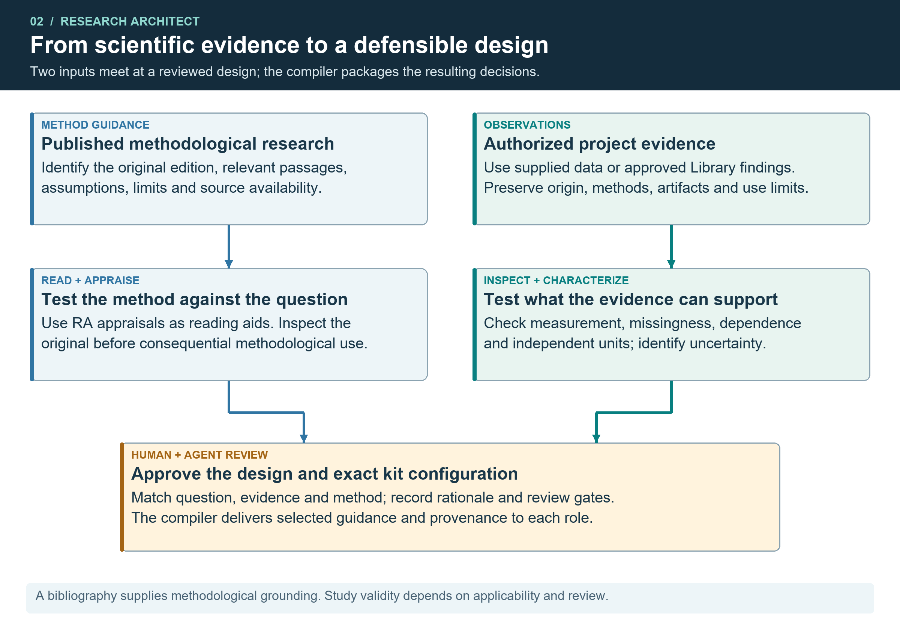
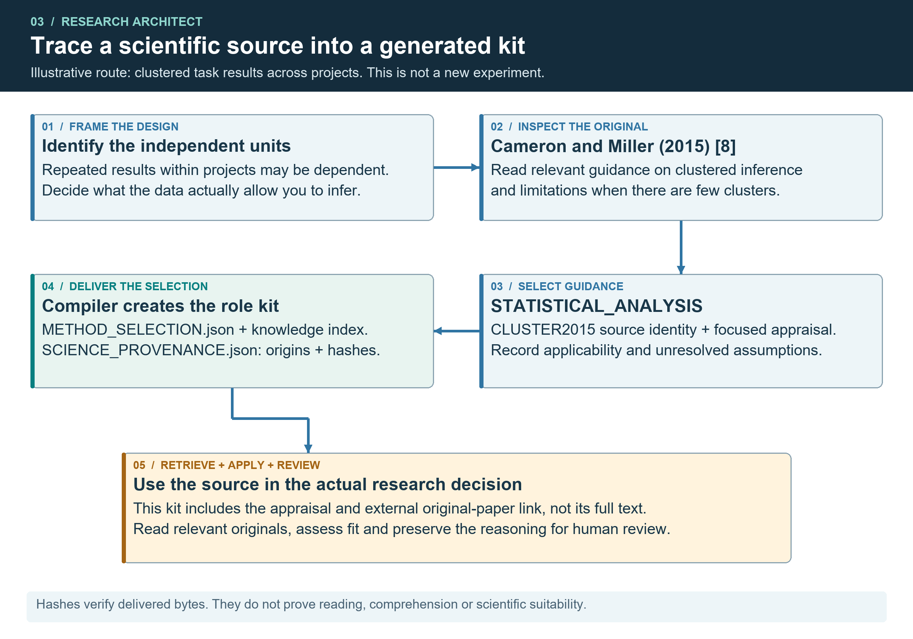
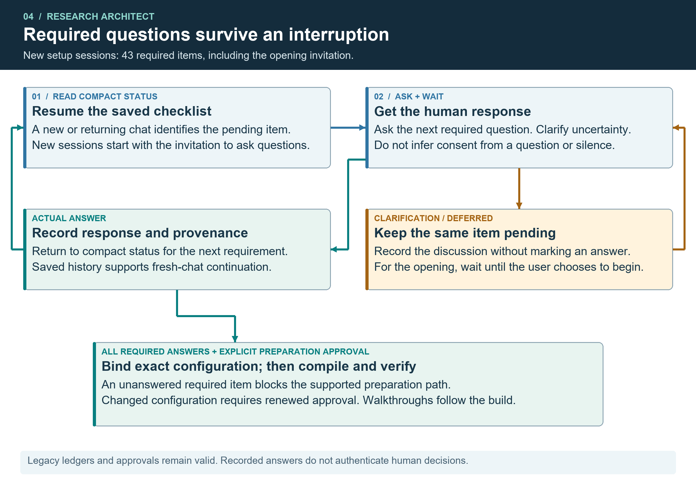
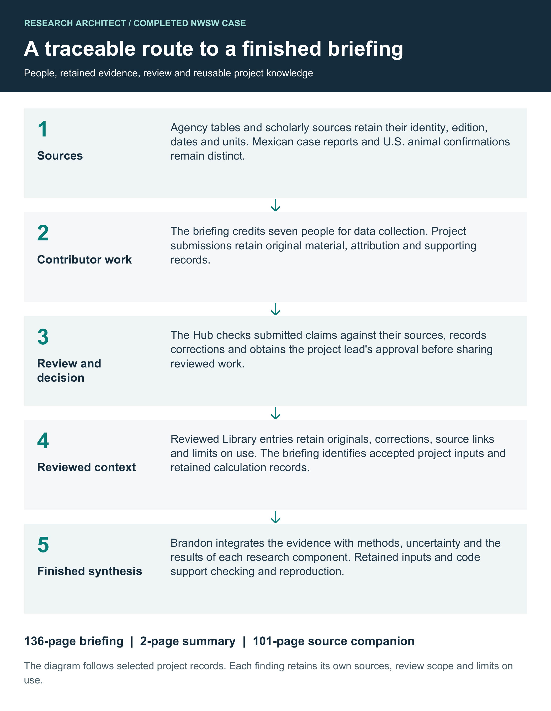

# Research Architect for Coordinated AI Research

Technical white paper with an operational case study from the NWSW project

Brandon Santor
Creator and Principal Designer of Research Architect
November 11 2026

## Executive summary

Research Architect provides an operating framework for human research teams working with AI. It helps design new work or organize an existing project around its retained evidence, decisions and constraints. The Architect proposes methods and feasible assignments; the accountable human chooses the design, authorities and consequential changes. A reviewed design becomes individual role kits with project instructions, selected methodological guidance, local helpers and continuity records. The New World Screwworm (NWSW) deployment supplied an active setting in which these mechanisms were used and refined. Its shared Library retains approved findings, methods, provenance, artifacts and use limits. The Hub alone publishes additions and corrections; Spokes and Ingestor read approved evidence directly within their permissions and return new contributions through the configured review process. [E5] [E6] [E11]

The documented results include creator-reported onboarding of eight people, verified remote exchanges, preservation of accumulated files during a live Hub upgrade and an isolated whole-project restore. The current RA 2.6.1 factory supplies executable setup-environment verification, review of the exact written plan before kit creation, scoped delivery and retained approval evidence. Local semantic checks examine declared data relationships, and claim-to-evidence checks reconcile stated quantities and quotations with pinned inputs. Incremental Library preparation, compatible retrieval and durable publication records support reviewed sharing. Deployment observations and software checks retain their respective scopes. [E1] [E2] [E7] [E10] [E20]

The completed NWSW case now extends from coordination records to a finished research product: a 136-page briefing, a two-page executive summary and a 101-page source companion, prepared November 8 and reviewed November 10, 2026. Brandon reports an eight-person effort over eight weeks; the briefing credits him as preparer and seven people for data collection. The record connects retained submissions, source checks, corrections and scoped human decisions with reusable project evidence and a substantial synthesis. It supports operational feasibility and traceability in this deployment. Comparative evaluation can assess total cost, productivity and research-quality effects across projects. [E16] [E17] [E18]

RA applies the established 10th man principle through explicit disclosure rules, preserved initial assessments, dissent and accountable human acceptance. Selective retrieval and durable checkpoints support continuity without reloading the entire project on every prompt. Retained measurements establish output reductions in their respective scenarios; further behavioral and comparative studies can extend the operational evidence. [12] [14] [E11] [E12] [E15]

Selected dated operational, release and completed-product results [E1] [E2] [E16]

| Capability | Documented result and scope |
| --- | --- |
| Onboarding | Eight people reported onboarded by the creator on October 16; one framework configurator. |
| Exchange records | 262 unique transfer IDs in the October 16 inventory; individual receipts establish delivery. |
| Live upgrade continuity | 701 exchange files preserved and rehashed during the October 13 Hub upgrade. |
| Project recovery | 123,098 files verified in the original October 11 isolated restore exercise. |
| Release verification | 171 offline tests passed on Windows; no model calls or remote transfers in that run. |
| Completed research product | 136-page briefing, two-page summary and 101-page source companion; prepared November 8 and print-checked November 10. [E16] |

This paper brings the engineering account to RA 2.6.1 while retaining the deployment case. Documented field operation includes Architect use in Codex and generated-kit operation across the reported Antigravity, Claude and Codex environments. RA requires a coding-capable agent workspace with persistent local files and code execution; any provider meeting those capabilities can qualify. The framework supplies usable software and coordination functions around existing models. Broader adoption and comparative research-quality effects remain questions for separate evaluation. [E7] [E8]

## 1 Introduction

AI-assisted research often spans several people, model sessions and collections of files. A useful answer becomes difficult to carry forward when the next session lacks its scope, supporting evidence, decisions or unresolved work. Teams also need to identify the current artifact, distinguish review from delivery and recover work after a session or machine changes.

Existing agent literature supplies useful design context. OpenAI describes models, tools and instructions as foundational components and discusses orchestration and guardrails. AutoGen demonstrates configurable conversations combining agents, tools and human input. Anthropic describes the coordination, evaluation and reliability work behind a deployed multi-agent research system. These sources inform the architectural context; their performance results are not evidence of RA performance. [1] [2] [3]

RA addresses the operating structure surrounding a research task. The Architect helps establish questions, assignments, methods, dependencies and review requirements. A compiler produces individual role kits and coordinated folders. Local helpers preserve state, inspect artifacts, prepare reviewed exchanges and support recovery. The selected coding-agent host supplies model inference and actual file/code access. These tools extend the workflow available to the agent without changing its model weights. Human operators retain responsibility for scientific judgments and consequential decisions. [E7]

## 2 System architecture

RA combines a reviewed project design, human-operated roles, persistent records and a shared project Library. Figure 1 separates Hub read/write access from Spoke and Ingestor read-only access. Only the Hub publishes additions and corrections. RA's scientific-methods collection supplies research guidance to the factory; the Library retains approved project findings for contextual reuse. Each host installation needs its own tested startup, storage and transfer configuration. [E3] [E4] [E5] [E6]

### Project design and role kits

The Hub issues bounded tasks, reviews contributions and validation results, obtains final human approval and uses its read/write Library authority to publish additions and corrections. Spokes conduct assigned work with their human operators, who accept and approve exact submissions. The Ingestor receives Hub-accepted work, validates it and reproduces results when needed, then returns its findings to the Hub. Generated kits carry these responsibilities, selected methods and continuity records. Generation does not grant remote access or establish scientific approval. [E6]

The Architect begins with the research question and the claim the team wants to support. Its methodological knowledge base combines research-design guidance, specialist chapters, worked cases, source appraisals and routes to original publications. Substantial reusable depth covers multi-agent behavior and evaluation, causal inference, hierarchical and Bayesian analysis, missing data, uncertainty, analysis selection and generalization. The Architect uses this material to examine observations, measurement limits, units of analysis, assumptions and appropriate checks. Method selection remains tied to the actual question, available evidence and qualified human review. Relevant original sources and project-specific guidance support consequential applications. [E4] [E11] [E19]

Specialized routes include multi-agent systems and AI/ML, planetary science and astrobiology, GIS and remote sensing, geochronology and geophysics, and computational omics. Standard routes cover experiments, observational studies, surveys, systematic reviews, qualitative inquiry, mixed methods and statistics. Across 41 routes, shared methods connect research design to worked analyses, conflicting evidence and target-population generalization. Instrument-specific procedures, professional standards and specialized questions receive project-specific sourcing and review. [E4] [E19]

The design also accounts for who has the expertise and time to conduct and review the work. The workload record includes available hours, methodological competence, deadlines, dependencies, anticipated rework and review burden. AI/runtime limits, such as tool availability, quotas, persistent storage and budget, enter the assessment when they affect feasibility. The Architect can recommend reassigning work, reducing scope, changing the schedule or obtaining focused specialist review. The human authority chooses the configuration; estimates retain uncertainty, and adding agents is not assumed to add useful capacity. [E11]

The human lead establishes project scope, decision authority, evidence-use boundaries and approval responsibilities with the team and applicable institutional requirements. Researchers remain responsible for their submissions and the access they control. The Hub coordinates work within those decisions; it does not acquire authority to expand access, change a study's consequential methods or accept a finding merely by recommending it. The Ingestor reports what it checked and reproduced, including unresolved discrepancies. Local software verifies defined technical conditions; qualified humans judge scientific adequacy and authorize consequential use. [E6] [E11]

Evidence boundaries have a research purpose. An item may be outside the agreed question, awaiting verification, restricted to a particular audience, or intentionally withheld until an independent first assessment is recorded. Such limits can protect confidentiality, preserve a valid comparison or prevent an unreviewed claim from becoming a shared assumption. Methodologically necessary information must not be concealed to manufacture a preferred result. The authorized human decides changes to these boundaries; the Hub records and implements the applicable scope, subject to actual host and storage permissions. [E11]

Research assignments, submissions, disagreements, proposed corrections and release decisions pass through the configured Hub routes. Approved Library lookups can occur directly. A participant's private conversation or local files become shared project evidence only when captured and delivered through an authorized route; the Hub does not automatically observe every device or conversation. [E6] [E11]

### Local agent workspace and verified setup

RA and its kits operate in an agent environment that can access persistent local project files and execute code on the machine. Codex, Antigravity and Claude Code are examples, rather than a provider whitelist. Uploading a ZIP to ordinary browser-only chat or running code in a temporary sandbox does not establish the required working environment. Manual file exchange and recovery remain useful between suitable local workspaces. [E7] [E8]

After the environment and Python responses, a bounded preflight requires an agent file challenge, saved readback and a result from an independent Python process. The environment respondent explicitly confirms the actual local agent workspace and persistent host. Missing, stale or withdrawn evidence blocks later intake and all supported kit-generation routes. File/code access is machine-checked; physical locality and long-term host durability are human-confirmed. The same saved evidence is rechecked on resume and before publication without repeatedly launching the worker. [E7]

### Model choices and operating costs

The Architect records the models and reasoning settings each operator can actually select, then recommends a default for each role. The plan includes the task rationale, expected cost tradeoff, available alternatives, switching conditions, an acceptance check and a retry limit. A single available model is valid; unavailable alternatives and unknown settings remain explicit. Recommendations based on documentation, operator experience or initial judgment are marked PROVISIONAL. MEASURED recommendations require comparable trial evidence and a dated reference. The compiler checks the record's structure and bindings, not the truth of a model-performance claim. [E11]

At runtime, an agent can recommend a stronger or lighter option under the recorded conditions. The human decides whether to switch, and actual access and provider permissions still apply. The agent reports its current model or reasoning setting only when the host exposes it or the operator confirms it. Routine integrity checks and diagnostics can run locally without another model call. Total cost assessment includes setup, review, failed attempts, saving and restoration; unavailable usage or billing remains unknown. Persistent local project storage does not imply local model inference: the selected host and provider determine where requests are processed and which material is transmitted. [E11]

### Written plan and scoped delivery

The finalized design produces a shared-team PDF and a Hub PDF. The shared edition contains the permitted team context and explicitly selected coordinator sections; the Hub edition also carries its approved coordinator records and setup responsibilities. Role-specific handoffs preserve the storage, transport, permissions, model plan, owners and pending actions relevant to each recipient. Generation does not configure cloud accounts or grant permissions. [E7]

Before kits can be created, the accountable human must approve the exact bytes of both plan editions, bound to the configuration and source snapshot. Compilation copies those reviewed PDFs unchanged and attaches separate review receipts. Changed configuration, intake or plan artifacts require renewed review; explicit refusal blocks creation. Existing approval events remain in history. The current build also requires the verified setup-environment receipt, so recorded prose alone cannot satisfy the local-capability requirement. [E7]

### Local semantic validation and claim concordance

Local Python checks bind CSV evidence to declared records, populations, periods, variables and units. They test types, missing-value codes, identities, allowed values, ranges, date windows and count/denominator relationships. Join checks expose ambiguous keys and projected row multiplication. Reports preserve original data, exact input identities, complete violation counts and labeled source-record samples; missing observations remain separate from zero. [E20]

Claim checks bind exact final-text passages to source artifacts and reconstruct declared counts, sums, means or record proportions. They compare complete numbers, explicit rounding tolerance, units, scope and required qualifications, and verify exact quotations. Failed semantic inputs block dependent numerical claims. Unchanged reports can be verified and reused, with complete details available through bounded continuation. These local tools make no additional model or network calls. Investigators judge scientific meaning, source suitability and acceptance. [E20]

### Persistent context and source retrieval

Supported startup resolves the designated current checkpoint rather than choosing a directory by timestamp. Successor snapshots preserve their base and record changed state. The current generated startup uses selective retrieval: it selects the declared source scope for the requested intent, emits each required control once and replaces only exact repeated original lines with backward references. Before publication, it reconstructs every selected source byte and checks the source bindings. Original records remain available. The classic multipart path, with repeated governing controls, remains an explicit alternative. These controls preserve selected text and detect missing or altered parts; they do not establish that a model has understood or retained it. [E11] [E12]

Ordinary questions use bounded lookup of the relevant records. Routine message or diagnostic operations have scoped routes; resolving the current checkpoint or checking files on disk does not require emitting every file into the model's context. Within the same conversation, compact reuse is permitted only after fresh local source and selector checks and explicit confirmation that all required selected context was read and remains available. A saved index cannot prove that retention. A new session, context loss, uncertainty or a changed checkpoint, source, instruction, reader or sealed Library configuration requires renewed context output. Complete restoration is an explicit operation over its declared scope. [E11]

The active context window is the material available to the model for its current response. Project records persist outside that window. If the host condenses older messages or a researcher opens another conversation, restoration retrieves the current controls, state and task-relevant evidence from those records. RA does not enlarge the provider's context window, guarantee unlimited cumulative retention or reload the entire project at every prompt. It also does not retrain the model's neural-network weights when the team corrects a finding. Saved decisions, mistakes and their resolutions become retrievable project knowledge; their correct use still requires checking. [E11]

The persistence protocol calls for saving at meaningful milestones, review decisions, handoffs, session closure and before expected context loss. A researcher can ask, for example, "Save my spot, record what changed and what remains unresolved, and tell me exactly where to resume." This is a natural-language instruction to invoke the save workflow, not a universal hardcoded command or an automatic guarantee. The agent updates the research and workflow state, session handoff, index and changed linked records; it preserves the previous confirmed checkpoint, verifies the saved bytes and reports the exact resume point and pending work. A failed or partial save remains PENDING. "Resume from the saved checkpoint" then requires identity and version checks and reconciliation of intervening changes. Information left only in an unsaved conversation remains vulnerable, and closing a session does not close its research workstream. [E11]

Figure 6 gives a worked example of focused retrieval after required startup. An invented 437,112-character record remains in storage while a 2,450-character working context carries the current question, human decision, unresolved issue and exact source routes. Retrieving the relevant original passages brings that task input to 3,716 characters, before the answer is added. The answer retains the approved exclusion interval and the pending sensitivity check. Other questions can require other records. These illustrative counts do not measure RA restoration or show the entire archive compressed into a short summary. Exact duplicate removal during restoration and conditional reuse of already-retained context are separate mechanisms, described above and in the measured results. [E11] [E12]

Figure 1  Roles and Library authority. Teal arrows show Hub read/write access for additions and corrections. Dashed blue arrows show Spoke and Ingestor read-only access. Contributions return to the Hub; Figure 5 details review. [E3] [E4] [E5] [E6]

### Shared Library and cumulative project knowledge

The shared project Library is a governed repository of approved evidence, findings, methods and artifacts. The Hub has read/write authority and alone publishes additions and corrections through the human-approved review route. Spokes and Ingestor have read-only access within their approved scope. The Hub controls reviewed audience selections and handles requests for held material; researchers and agents reuse published knowledge with its provenance and use limits. Per-role setup records identify Library status, configuration, responsible people and remaining actions. This supplies the shared-learning mechanism as project knowledge accumulates. [E5] [E6] [E14]

Discovery preserves canonical artifact and version identities, original locations, dependencies, review status and correction relationships. Membership references let one canonical item appear in several collections without duplicating the research output. Extracted packages retain their relative paths and parent bindings. A Hub-published correction can be exposed through both the canonical record and its discovery routes, helping agents recognize which version and limitations apply. [E5]

The outward availability labels are Available in Library and Request from Hub. Already-approved files and verified aliases remain usable within their original scope without repeating approval; safe metadata for held work directs a request to the Hub. Shared views use reviewed audience selections and omit restricted internal records. The Library is distinct from RA's bundled scientific-methods collection: the former retains a team's evolving evidence and outputs, while the latter supplies reusable research guidance for configuring kits. [E4] [E5]

A researcher can discover reviewed catalog metadata for held work without receiving its payload or permission to use the finding. A request should identify the exact artifact and version, explain the research dependency and intended use, and retain audience and other relevant limits. The Hub checks whether the item is located, cleared, still under review or unavailable. It can coordinate remaining checks and recommend prioritizing review or release; the human lead decides consequential changes to assignments, deadlines or access. In the inspected NWSW configuration, requests use the participant's existing Hub route and inform Brandon's review priorities. Fulfillment is not guaranteed, and restricted metadata or unlocated acquisition leads need not appear in shared discovery. This deployment illustrates the generic discovery/request capability; it does not establish a universal automatic prioritization queue. [E14]

### Evidence review and decision traceability

The Hub defines a bounded task with scope, inputs, methods, artifacts and acceptance criteria. The Spoke performs it, and its human approves the exact submission. The Hub reviews and accepts it for Ingestor validation and any needed reproduction. The Ingestor returns checks, discrepancies and limits. The Hub obtains final human approval, publishes the exact version with its use scope, and verifies publication. Failed checks return for correction and repeat affected reviews. Other roles propose Library corrections; only the Hub applies and publishes them, preserving prior versions and decisions. [E6]

Human-agent discussions can preserve the decisions, alternatives, objections and reasoning behind an output. The supported reviewer-bundle helper binds supplied conversation files and their declared session coverage to the research package for Hub review. All relevant supplied discussion remains available as evidence; summaries do not replace the transcripts. The helper does not automatically capture every host message, tool call or attachment, so missing coverage must be declared. Transcripts stay in restricted review storage; publishing a research finding does not automatically disclose its raw conversations. [E6]

### Applying the established 10th man principle

RA applies the established 10th man principle as a deliberate challenge to apparent consensus. The familiar formulation assigns someone to examine the possibility that the prevailing conclusion is wrong. Professional discussion uses the name, and the underlying practice of devil's advocacy has a longer history. In Psychology of Intelligence Analysis, the CIA's Center for the Study of Intelligence describes assigning a reviewer to develop a minority interpretation and expose assumptions behind competing views. RA adapts that approach to coordinated human-AI research; it does not claim to originate the principle. [12] [14]

Every new Hub, Spoke and Ingestor kit now carries explicit instructions for Hub-controlled disclosure and preservation of the initial assessment. Before a Spoke receives another Spoke's output, the sender and recipient must verify the current Hub authorization, recipient, task/use and exact output/version or approved collection scope, together with required human authority. Existing valid releases and Hub-approved Library publication remain usable within their recorded scope. For a comparison task, the agent must save and verify its own initial assessment before seeing the other interpretation. Later comparison preserves that initial version and records actual exposure and revisions. The accountable human makes the acceptance decision. [E6] [E11] [E15]

Operational awareness means knowing each agent's assignment, the evidence and interpretations it has seen, its authorized access, current decisions and conditions for stopping or escalating. The Hub coordinates that awareness through task, disclosure, handoff and review records. Every kit's startup instructions route to the shared rules. Its review and handoff fields retain the release, inspected evidence, initial conclusions, uncertainty, objections, exposure and exact saved assessment reference. Resume retrieves the relevant task records; it does not load the entire review history. A failed save leaves comparison pending. An already-exposed assessment cannot be relabeled as an unexposed first assessment. These operating instructions and records preserve existing approvals and closed work; host access controls and actual compliance remain separately established. [E6] [E11] [E15]

Focused delivery checks generated one fresh kit for each of the three roles. They confirmed both startup entry points, review and handoff fields, and preservation of both requirements through classic and selective context restoration. The existing integrity check detected an altered sealed instruction and stopped restoration. Prior exact-PDF review bytes and retained source fixtures were preserved. These completed checks establish instruction delivery and restoration in the exercised paths. Continued behavioral evaluation can examine how models apply the procedure and how project records capture actual exposure. [E15]

The responsible human and Hub define the challenge question, appropriate evidence access, reviewer or review mechanism, stopping conditions and decision authority. The reviewer tests credible alternatives and may conclude that the original result survives scrutiny. After an independent assessment, the Hub may authorize scoped comparison while preserving dissent for the human's final decision. A leading assignment, accidental disclosure or unauthorized access can compromise independence without a deliberate human decision to seek agreement. The process stops when the issue is resolved, available evidence cannot distinguish the alternatives or the authorized budget is exhausted; unresolved concerns remain visible. [E11]

For consequential findings, the governance guidance recommends qualified independent review or an appropriate challenge mechanism when feasible. The record identifies any overlap between the Hub operator, contributor reviewer and final authority. Where staffing calls for documented self-review, the authorized human records the checks, remaining uncertainty and actual decision, subject to applicable institutional requirements. This keeps small-team work practical while making the basis of review inspectable. Continued evaluation can measure adherence to the safeguards and their contribution to error detection, evidence quality, review cost and final decisions. [13] [E11]

### Outside research and focused specialist review

A published study, agency dataset, external analysis or commissioned report can be brought forward by the lead, a researcher or the Hub within the project's authorized scope. Existing task, validation, review and publication mechanisms support bounded review of that material. The team's responsible human authorizes its submission and intended use; original authorship, access restrictions and provenance remain attached. Today this route uses the established mechanisms with project-specific preparation. A dedicated external importer and further end-to-end qualification are areas for continued development. [E11]

The handoff needs the exact source and edition, citation or stable locator, relevant supplements, the specific claim or question to check, and available reproduction materials. Where applicable, those materials include data, code, parameters, environment requirements and expected outputs. Missing data, inaccessible methods and unresolved dependencies remain explicit. The Hub sets acceptance criteria within the approved task, the Ingestor reports checks and actual reproduced results, and the Hub obtains the required human decision before publishing an exact version and its permitted use. Reviewing citations and methods is different from reproducing results. If reproduction cannot be completed, the record must state not reproduced or blocked, with the reason; qualified evidence use may still be possible. [E6] [E11]

A focused outside specialist can review a method or finding without receiving a new Spoke kit. Using ordinary document-authoring tools, the Hub agent can prepare a readable packet containing the review question, exact versioned material, necessary project context, evidence and methods, known limitations and requested checks. Material deliberately withheld for an independent first pass is identified in the review record. The specialist's returned assessment records their identity, expertise relevant to the question, checks actually performed, conclusions, disagreement and any remaining conditions. The Hub preserves that return and routes consequential decisions to the authorized human. [E11]

RA supplies a review-record template and workflow guidance; a readable packet can be assembled from those records. PDF or Word export uses the tools available in the host. A dedicated automatic specialist-packet exporter remains a future automation step. Delivery, completed specialist review and the human's decision retain separate records. Focused consultation also provides an option when a full new participant-and-agent onboarding would exceed the project's available capacity, as discussed in Section 7. [E11]

### Versioned handoffs and recovery

Local helpers stage payloads, validate configured routes and retain receipts. Authorized host connectors perform remote transfer during active sessions. Preparation, delivery, reading, adoption, research acceptance and permitted downstream use remain distinct. Backup helpers verify selected project contents and captured external files, retain explicit recovery metadata and exercise restoration. Storage and transport configuration remain responsibilities of the deployment.

### Diagnostics and repair coordination

The Doctor diagnoses the explicitly selected kit and its configured components. It leaves the sealed kit unchanged while writing external reports and diagnostic-operation records. Its seven scopes cover identity, context, storage, messages, Library, backup and recovery. Compact findings retain complete evidence through bounded continuation. A clean result establishes the checked technical state, rather than scientific approval, and diagnosis does not itself authorize repair. [E7]

The Hub can coordinate a repair and relay the configured human authority's actual, bounded instruction to a Spoke. The Spoke's agent performs permitted work locally, subject to its operator/host controls and the recovery tool's checks. RA supplies no general Hub-issued repair capability or remote-control channel. For example, lock recovery requires the inspected lock hash, the same host and a proven dead owner process. Checkpoint recovery retains its clean-base, review and publication requirements. This preserves practical maintenance coordination without treating a Hub message as a tool grant. [E7]

## 3 NWSW deployment

The NWSW project provided an operational case for RA-generated kits and a coordinating Hub. The creator reported onboarding eight people by October 16, 2026, while remaining the only person who had run or configured the Architect itself. This is evidence of participant onboarding in a creator-supported deployment, rather than eight independent framework configurations. [E1]

The creator also reports running the Architect in Codex with Astra and 6.1 High, using those supplied model/setting labels, and running generated kits in Antigravity, Claude and Codex. Early field use established the need for persistent local coding-agent workspaces, and teammates migrated from browser chats to that supported environment. These are field-use reports, distinct from the smaller scripted early-intake trials. The operational account complements older technical reports that did not record every host name. [E8]

The Hub maintained exchanges, source routes, instructions and checkpoints while the team continued assigned work. The original engineering case examined selected operational records from October 8 through October 16. Later context, review and Library examples retain their October observation dates. The completed briefing adds a November 8 product, reviewed November 10, together with its retained source and calculation records. The historical engineering counts and later research outputs describe different work units. [E1] [E7] [E8] [E9] [E12] [E13] [E14] [E16]

Generic RA, the deployed NWSW coordination system and the independent NWSW Spatial Evidence Workbench are separate systems. The Workbench's web interface, database, spatial features and application tests are not capabilities or validation results of the RA distribution. The cases below describe operational review, correction and coordination in the customized Hub workflow. They do not publish contributor research payloads or establish that every generated kit automatically performs the same checks. [E13]

According to Brandon's project account, the research involved eight people over eight weeks. The completed briefing names Brandon Santor as preparer and credits Ethan DeMelo, Khushal Gummadi, Carter Grout, Brodde Stanford, Emie McCoy, Will Gray and Roberto Ortiz for data collection. These credits distinguish the lead's integration and analysis from the contributors' collection work. RA supplied the project framework and supporting tools; the people and their configured agents carried out the research. [E16]

## 4 Operational results

### File exchange and instruction continuity

The October 16 inventory recorded 98 incoming and 164 outgoing tickets with 262 unique transfer IDs. Tickets identify prepared exchanges; separate readback records support actual delivery. The October 8 repair distribution comprised 15 logical transfers and 30 remote objects. The October 13 distribution comprised 10 transfers and 20 remote files. The retained checks bound delivered objects to their intended destinations and bytes. [E1]

A complete versioned instruction was delivered through seven participant routes in October. Its register retained identity, version, supersession and observed delivery, with a subsequent report of retention and application. That report does not establish seven persistent installations. Later diagnostic returns and exported execution records strengthened evidence for participant-side setup and multipart restoration, while remaining distinct from independent observation of every device. [E1]

### Continuity during engineering changes

The authorized October 13 Hub upgrade preserved and rehashed 701 exchange files, totaling approximately 1.66 GB. Its preceding exchange store and pointer remained unchanged. The post-activation exercise combined file-hash comparison with inventory checks and verified restoration records. This is a demonstrated preservation result for that upgrade, rather than a guarantee that arbitrary concurrent writers can be merged safely. [E1]

An October 15 native Windows context-repair fixture reconstructed a 466,824-character startup section through five resume parts and eight full-context parts. The largest part contained 189,188 characters under the unchanged 200,000-character ceiling. Checks included Unicode and CRLF reconstruction, repeated controls, missing or altered parts and later checkpoint restoration. These are synthetic engineering checks, separate from participant adoption. [E1]

### Whole project backup and restoration

The October 11 capture covered 48 included Drive folders, 744 source files and 748 downloaded or exported artifacts, together with local project contents and dependencies. The original isolated restore verified 123,098 files totaling approximately 20.88 GB without using live sources. It materialized recorded dependencies and completed restored integrity and context checks. [E1]

A later authorized content amendment produced a separately documented backup inventory. It does not replace the historical restore result or authorize resurrection of excluded bytes. The deployment's two-copy rolling policy is project-specific; the reusable tools accept explicit retention configuration. Local backup and restore were evidenced, while actual offsite delivery was not established by the inspected capture records. [E1]

### Shared Library implementation and publication recovery

The NWSW implementation established preserved holdings, a private census and evidence registers, immutable shared catalog generations, approved stored files and a pinned deployment graph. Readers follow the current designation through the deployment and relevant collection pages. This supports targeted discovery without scanning all research payloads or loading the full collection into model context. The implementation preserves prior versions and exact review bindings when registering reviewed additions and corrections. [E5]

The retained recovery completion records successful verification of the selected catalog, 58 convenience aliases and the status record, followed by guard release. Its final current-pointer observation was October 22, 2026 at 11:51 p.m. Central Daylight Time (October 23 at 04:51 UTC). Separate Hub activation completed at 12:30 a.m. CDT on October 23. These are completed, dated operational results. They establish the recorded publication and recovery outcome; contributor rollout and recipient reading remain separately tracked. [E5]

The October 27 incremental Library publication verified its shared index, navigation, status and normal guard closeout. Its final receipt records 741 selected metadata objects reused, 28 new metadata objects, nine changed aliases verified and 49 unchanged aliases retained. Reuse relied on dated baseline proof and pinned cached bytes, without a fresh full cloud audit. This demonstrates metadata reuse in that deployment; token costs were not measured. The receipt preserves original interrupted-controller qualifications. Participant adoption, scientific acceptance and standing unlock authority were unchanged. [E9]

### Research review and coordination in deployed work

An October 29 package assessment found a submission describing a complete set of source records as available, while its retained original explicitly said that the complete roster or independent receiving ledger had not been obtained. The Hub's AI-assisted review identified the contradiction and produced a corrected reader that retained the missing-record qualification. Original packages and the correction lineage remained preserved. The contributor's guided review authorized the exact original submission, not subsequent Hub edits. Brandon separately authorized qualified descriptive use and existing-team Library publication; the release receipt records completed Library publication at 20:26 UTC on October 29. The additional NWSW adviser was an AI agent, not an independent human scientific reviewer. This was a documented correction and bounded release, not independent scientific validation or evidence of participant adoption. [E13]

An October 14 coverage correction separated observation dates from report preparation, final-report and download dates. It made source units and missing coverage explicit. Applying a historical observation cutoff to a later database did not reconstruct the database's historical contents or active statuses. Where the requested historical view could not be established, the corrected output displayed unavailable. Originals were retained, and that correction pass did not rerun the existing simulations or establish independent scientific acceptance. The observation concerns that dated pass; later project work retains its separate status. [E13]

An October 29 visualization correction addressed positive coloring in areas with zero source reports. Brandon authorized a corrected derivative of a contributor's original map, and the Hub with Codex assistance changed the display while preserving source records, dates, identifiers and geometry. Retained verification covers 25 movie frames and 475 county-interior pixel probes, plus 114 pixel probes across six additional temporal boundary dates. A relocated-export comparison also passed. The temporal checks concern dates, not geographic borders. This was rendering verification against the pinned source, not independent corroboration of the underlying research; the receipt does not establish Library release. Credit for the original and the correction remains distinct. [E13]

An October 21-22 closure exchange distinguished the human's decision from its reported application. Brandon closed eight assignments and reserved reopening to later authorization. A received contributor-side report stated that the registry and workbook were saved, reloaded, refreshed and reloaded again, with all eight remaining complete, inactive and outside pending review. The Hub verified the received report's bytes. It did not inspect the contributor's workbook directly. The case supports recorded administrative closure and reported persistence while preserving history, not new scientific acceptance or a guarantee against later regressions. [E13]

An October 26 route repair found that a contributor's incoming folders had been omitted from configured Hub scans after an earlier repair incorporated only the outgoing route. Under the lead's instruction, the Hub added the existing research/status and restricted-review routes and their explicit bindings, preserved prior configuration entries and verified activation of the repaired checkpoint. No cloud-sharing change was required. A missing scan result therefore did not establish that the contributor had sent no work. The case demonstrates detection and repair of a configuration omission; it does not establish infallible routing or contributor adoption. [E13]

The retained-evidence audit completed on October 28 Central time classified 126 propositions: 58 as Establishes, six as Suggests, 12 as Consistent with and 50 as Does not show. These labels grade what the inspected evidence supports; Does not show does not mean false. The audit distinguished file enumeration and hashing from claim-level assessment, retained source references and uncertainty, and preserved its earlier baseline. Some checks reused retained evidence, and the inventory was not an atomic crawl of all live state. AI advisory review did not supply independent human validation, scientific acceptance or Library publication. [E13]

These deployed episodes document specific checks, corrections, authorizations and reported outcomes. They provide practical evidence of evidence traceability, source correction, date interpretation, operational reconciliation and review provenance. Repeated reviews remain linked to the same episode so the record preserves the actual unit of work. A comparative study can build on these cases to measure error prevention and research outcomes relative to another workflow. [E13]

### Completed research product

New World Screwworm: Reported Spread, Surveillance Gaps and Geographic Priorities is a completed public-source academic research briefing. Its cover states that it was prepared for Rear Admiral Michael Schmoyer, Ph.D., USPHS, Associate Administrator of USDA APHIS and Director of the New World Screwworm Directorate. The selected artifact contains 136 pages, prepared November 8 and reviewed November 10, 2026. A separate two-page executive summary and 101-page Retained Sources and Reading Notes companion match the final print-review receipt. The receipt records a completed document and source-consistency review; the prepared-for statement identifies the intended reader, rather than recording agency receipt, endorsement or adoption. [E16]

The product organizes eleven research questions, five follow-up questions and appendices, followed by source and reading notes. It identifies source facts, project calculations, analytic judgments, hypotheses and unknowns. Questions end with a plain-language judgment and its confidence basis. The source companion provides 101 reference-specific access and role records. This gives readers both a concise account of the findings and routes back to the material supporting them. The document lengths describe the scope of the finished outputs; scientific strength comes from the evidence and methods attached to individual claims. [E16]

### From submissions and corrections to reusable evidence

The October 29 review described above shows how a submitted synthesis became reusable project evidence. Source checks refined the claims about tracing records and weather conditions, while preserving the original submission, useful findings and correction history. The following approval and publication records show how the team made that reviewed account available for continued work. [E13] [E17]

On October 29, Brandon approved the corrected account for descriptive use and sharing through the existing team Library. The approval identified the exact files and the claims they could support. The completed release added three versioned Library items and fourteen index links while preserving the earlier entries. It separately credited the contributor's preparation, Brandon's Hub corrections with Codex assistance, and earlier accepted contributor work. The team could retrieve the reviewed finding, original submission and correction history together. [E17]

The finished briefing identifies accepted project inputs, including the infrastructure package used for transportation context, and names the retained weather synthesis and calculation records behind other sections. The source companion links those research objects to the report's references. Together, the selected records show how distributed work can become inspected, attributed project context and then support a finished briefing. They document particular stages of the workflow; the case does not imply an automatic import from every Library release into the report or identical review coverage for every paragraph. Figure 7 summarizes that route. [E16] [E17]

### Source reconciliation and retained methods

A dated project audit recovered 2,629 previously missing outbreak-start dates by exact source identifier and checked all 45 previously dated comparison records after date normalization. Original blank fields were preserved; enriched fields retained source references, response hashes, match status and uncertainty. The retained receipt records no remaining missing dates or uncertain matches in that selected set. Its scope concerns the date field: the recovered values are outbreak starts, while sampling, confirmation and notification dates retain their own meanings. The repair leaves location precision and overlap between source families as separate questions. [E18]

The completed briefing applies the same discipline to comparisons. Its principal June 3-October 3 synthesis distinguishes 18,070 Mexican case reports from 52 individually confirmed U.S. animals. A Mexican report can contain more than one animal, and investigation and confirmation dates mark different stages. Later export dates and later cumulative totals remain separately labeled. This preserves what each count means and prevents a source update from silently changing the analysis window or turning unlike totals into comparable rates. [E16]

The record also retains assumptions and inputs for location-uncertainty work. The reported 64-million-trial experiment repeatedly allocated the same source records under fixed location scenarios. It met the stated numerical-precision criterion within those assumptions. The trials were simulated allocations, rather than 64 million observed animals or independent experiments. Their contribution is a checked account of numerical sampling error; the source geography and allocation assumptions determine what can be inferred about location. Methods, source roles and retained analysis references travel with the result. [E16]

### Component findings and further research

A later U.S. retrospective comparison used 52 animal confirmations dated through October 3 and evaluated 56 confirmations dated October 4-November 3. The highest-ranked 20% of mapped county area contained 51 of the 56 later confirmations, or 91.1%. That selected area was approximately 345,956 square kilometres across California, Arizona, New Mexico and Texas: 66 whole counties and part of another. All 51 captured records were in wholly selected counties. The broad area is an important denominator; the result describes concentration among reporting counties, rather than exact animal locations. [E16]

The report evaluates each component on its own terms. County-level allocations require further refinement, and a separate count formula estimated 3.63 additional confirmations against 56 recorded. Road proximity added little consistent benefit across the retained comparisons. Keeping these findings alongside the broad-area capture result identifies where each method is useful and where additional research can improve it. The inputs and evaluation were assembled retrospectively; these were date-filtered component checks, rather than a prospective, analyst-blinded forecast. [E16]

### Practical contribution of the completed case

The operational contribution is the connection between assigned work, preserved submissions, source-linked corrections, explicit human decisions, reusable findings and a finished research product. RA gave the team a framework and local tools for maintaining those relationships across files, people and sessions. Brandon coordinated the design and integration; the named contributors supplied collection work; their agents assisted within the configured roles. The finished deliverables and selected receipts establish that this process supported a substantial completed inquiry in one deployment. [E16] [E17] [E18]

The briefing's methods draw on agency records and published research, with documented assumptions, checked calculations and retained inputs/code for reproduction. That grounding and the project's documented reviews have their own scope; independent peer review of the completed report would add a further form of assessment. The case supports operational feasibility and traceability. Time saved, comparative productivity and general scientific-quality effects are questions for a comparative study. Further research can continue while this particular briefing, summary and source companion remain completed deliverables. [E16] [E17]

## 5 Engineering improvements and release verification

Field operation exposed requirements for stable state selection, reliable Windows publication, growing context and recoverable exchanges. RA 2.1.0 distribution revision 2 ports reusable mechanisms into a separate package while preserving earlier source and deployed project history.

Capabilities in the inspected RA 2.1 distribution

| Capability | Implemented mechanism |
| --- | --- |
| Current state selection | Verified designation, identity and manifest checks; invalid selectors stop affected work. |
| State publication | Separate successor snapshots, destination-local staging and expected-base checks. |
| Context continuity | Bounded retrieval and exact multipart restoration with repeated controls. |
| Exchange records | Configured local staging, version-bound receipts, idempotent repeats and guarded lock recovery. |
| Project recovery | Resumable capture, explicit retention, dependency materialization and standalone restore tools. |

The October 16 release receipt records 171 passing offline regression tests in eleven groups on Windows and Python 3.12.10, with zero failures, errors or skips. Coverage included kit generation, checkpoints, context reconstruction, local exchange, affected evidence services, extracted-package generation and rebuilding, and backup recovery. The run made no model calls or remote transfers. A retained integrity comparison found all 278 recorded source hashes unchanged. [E2]

Instruction maintenance has a separate boundary. RA records stable IDs, complete versioned text, authority, applicability and explicit supersession. Routine Hub saves may append evidenced observations about an existing instruction, but cannot define or rewrite a rule. A new startup instruction requires reviewed reconfiguration and verification that the selected installation actually loads it. Delivered packages and acknowledgments alone do not establish fresh-session behavior.

The deployed Hub continued to evolve after the historical RA 2.1 package freeze. Later context and message improvements informed the reusable RA 2.3 implementation and remain in the current factory. In a retained repeated-context fixture, emitted prompt length fell from 773,391 to 119,362 characters, an 84.5664% reduction, with matching source hashes and complete reconstruction; confirmed same-conversation reuse emitted 277 characters. These are scenario-specific output measurements. Provider-token counts, billing and whole-task productivity are separate measures. [E1] [E7]

### Measured reductions in returned context

The participant optimization report retained a controlled local replay against the same CP076 source checkpoint. The startup/resume comparison returned 1,346,562 characters before optimization and 160,808 afterward, an 88.0579% reduction. The unchanged subsequent-turn comparison returned 1,346,571 and 6,333 characters, respectively, a 99.5297% reduction. Cold replay used one context part instead of seven and eight logical reader calls instead of 59. These measurements include the protocols' complete stdout and the counted startup instructions; they are not tokenizer estimates or complete model-request sizes. [E12]

| Retained comparison | Returned character counts and scope |
| --- | --- |
| Generic repeated-context fixture | 773,391 to 119,362; 84.5664% reduction. Confirmed reuse emitted 277 characters. |
| Participant cold startup or resume | 1,346,562 to 160,808; 88.0579% reduction in controlled local replay. |
| Participant unchanged subsequent turn | 1,346,571 to 6,333; 99.5297% reduction in controlled local replay. |
| Hub message-workflow observation | 113,239 to 9,149; 91.9206% reduction in returned tool-result characters across different workloads. |

The participant replay verified selected-source reconstruction and preserved originals. Intent-based selection left historical material available for explicit retrieval. The replay was a local CLI measurement, not a fresh AI comprehension experiment; confirmation of retained model context remained a caller assertion. Provider framing, the surrounding conversation, cached input, generated responses, reasoning tokens and billed cost were outside its totals. Local source checks still perform work even when little text is emitted. The 6,333-character return does not mean the whole conversation or all provider input was that small. [E12]

The Hub comparison recorded 113,239 returned characters before the scoped message path and 9,149 afterward. It was a retrospective observational comparison in the same chat/model, with different checkpoints, histories, folder/object counts and closure work. It therefore cannot isolate the optimization's causal effect or be treated as an identical-input benchmark. The retained report preserves usage-counter definitions and unavailable evidence rather than converting character savings into a billing percentage. These three evidence settings, including the earlier generic fixture, remain separate and should not be pooled into a universal RA savings rate. [E12]

### Current factory configuration and verification

The current factory is RA 2.6.1, with operational runtime 2.4.0 and scientific library 1.9. These identifiers distinguish kit preparation, operational helpers and methodological content. Manifests and startup text identify the delivered components. Factory updates carry forward the existing Library, context, backup and exchange mechanisms while adding configuration and delivery controls. Existing deployments and dated measurements retain their original identities. [E3] [E6] [E7]

New sessions use a persistent setup ledger with 43 baseline questions and additional required followups. Compact status identifies the pending item on each turn and after resume. Environment/Python answers require the separate verified preflight before later intake. Ordinary compilation then requires completed responses, explicit human preparation approval, the exact configuration binding and current review of both plan PDFs. Deferrals remain pending; changed decisions preserve history and reopen affected work. Build verification and each operator's walkthrough remain separate completion stages. Existing protocol-1 ledgers retain their 42-item catalog and historical approvals. [E3] [E6] [E7]

The RA 2.5 revision 1 verification exercised the changed question workflow, interrupted and stale-state paths, configuration binding and the extracted package. A synthetic four-role project compiled, each generated kit passed its consistency check and actual operator walkthroughs remained pending. Three teaching-runner defects were repaired: all-failed-project handling, infeasible sensitivity shifts and bounded duplicate-safe JSON input. Revision 2 changes release identification and documentation; its adjacent integrity receipt records only those changed-path checks. [E3]

The scientific collection now contains 148 reference records and 38 local reference texts, with 21 targeted source appraisals. Six earlier appraisals retain their October scope; fifteen dated supplement appraisals distinguish reported research inspection from direct integration checks. Complete runnable teaching cases address clustered workflow evaluation, nested model selection and target-population generalization. They pair declared plans, fixed data, analysis, diagnostics and bounded conclusions with applicability safeguards. Large source bodies remain retrievable on demand. These counts describe coverage and availability, with inspection scope recorded for each source. [E3] [E4] [E19]

The safeguarding collection includes seven focused guides, four review templates and an invented worked case covering data meaning, claim concordance, design and validation, source changes, input authority and review. All kit roles receive common guidance, including methods-pending setup; all 41 method routes provide deeper material on demand. The discovery map retains 274 DOI/locator identities from 279 citation rows and 29 bias-control options. Curated source records, discovery references and independent studies retain their distinct identities. Local declared validation complements the methodological guidance and existing human review. [E19] [E20]

Forty-one focused tests cover semantic checks (17), claim checks (15) and affected regression hot spots (9), including stale evidence, interrupted publication, preserved approvals, report reuse and complete Unicode transport. A supported four-role build and delivered Hub execution verify that every role receives the tools and pinned example. The records establish these local checks and delivery at their stated scope. [E20]

The reusable Library integration introduced in RA 2.3 remains in RA 2.6.1. Every generated role receives a configurable discovery client that verifies catalog revision, hashes, byte counts and audience, preserves complete matching metadata through continuation and prepares submission records for Hub review. The discovery client grants no write authority. Spokes and Ingestor have read-only Library access; the Hub has read/write authority and uses authorized tooling to publish additions and corrections. Earlier registration/discovery evidence is retained. Generating a kit does not install the NWSW backend or grant access to its holdings. [E3] [E5] [E6] [E7]

The opening invitation is the first required item in new protocol-2 sessions. Questions about setup remain pending until the human chooses to begin intake. Targeted compiler checks rejected 14 representative required-item omissions and preserved legacy ledgers and approvals. In a two-turn fresh-chat test using gpt-5.6-sol at low reasoning, the agent asked the invitation, explained approval and recorded a request for explanation as a deferral with zero answers. These results document early-intake behavior and structural gate enforcement. [E6]

The written-plan implementation was checked through eight focused test groups. The exact-PDF review gate was then exercised through eleven review-to-build groups and five refusal/renewal checks. Successful compilation copied the reviewed bytes while rendering was disabled; changed plan evidence blocked publication. Separate role-delivery checks verified local-runtime instructions in fresh Hub, Ingestor and Spoke kits and their resume context. These records establish the particular software paths exercised, rather than a new complete interview or independent team trial. [E7]

The current environment gate passed eight focused groups and six additional negative entry-point checks. Unsupported answers could not complete step 1, and missing evidence blocked readiness, approval, workflow-backed export and normal/draft/direct generation. Changed evidence, host/workspace drift, code failure or timeout and withdrawn confirmation remained blocked. One successful four-role build preserved the earlier configuration and PDF approval bytes; an interrupted-publication case stopped after capability evidence changed. These are synthetic engineering scenarios using real file/code execution. They are distinct from the field deployment and retain the underlying test receipts. [E7]

### Incremental Library preparation and durable publication evidence

Generated kits include local tools for applying an exact reviewed metadata delta to the existing pinned catalog. Routine updates reuse unchanged records and apply changed metadata; they do not require a fresh holdings inventory or full catalog rebuild. An unchanged selection produces no candidate or upload actions. The preparer checks the selected local metadata graph, rejects stale or conflicting inputs and preserves Library identity, storage, audience and access policy. The Hub alone receives the publisher startup route, and the preparer command rejects other roles. [E10]

The compatible reader authenticates each object's original content revision separately from the selected catalog, retaining exact source-page provenance and complete records through page and entry continuation. Existing strict readers remain supported; the new contract requires reviewed configuration. Metadata and delta envelopes are bounded to 22,000 UTF-8 bytes. Complete preparation reports retain upload and reuse lists while the default console response is bounded to 4,096 bytes. These controls bound transport without discarding the underlying evidence. [E10]

Receipt helpers preserve exact literal JSON through hash and length checks, exclusive storage, flushing and readback. Failed or denied persistence stops the operation. A local evidence check requires retained provider acknowledgment, downloaded-byte and destination/access proof, and existing scoped authority before saving its result. It performs no cloud write or lock release. The configured backend retains the owned writer guard, final current-pointer selection, readback and supported matching-token release. Repair-only authority remains bounded, and existing approvals and closed work remain in force. [E10]

Retained RA results record 19 publisher-specific test methods and one legacy-reader regression, including generated-kit delivery and Hub-only command behavior. Three later failure checks cover competing destinations, evidence changing after receipt storage and report-write failure. All stopped without returning success and retained recovery evidence. These local checks support the portable integration, separately from the deployed publication. [E9] [E10]

## 6 Research basis and methodological applicability

Multi-agent design requires explicit coordination and verification. Cemri and colleagues distinguish system-design, inter-agent alignment and task-verification failures. RA uses this taxonomy to examine pending questions, task drift and incomplete completion checks. Applying the taxonomy is an engineering interpretation, not evidence that RA shares the study's failure rates or has eliminated those failure modes. [4]

AI Agents That Matter argues for cost-aware evaluation, credible simpler baselines and holdouts matched to the intended generalization. RA adopts these considerations when planning comparisons: report the full retry policy and task denominator, and distinguish emitted characters from measured tokens and billed cost. The appraisal uses the explicitly identified 2024 author edition; it does not treat later publication as evidence of a new RA experiment. [5]

CORE-Bench evaluates computational reproduction using supplied code and data. Its inspected author version and separate journal publication identity are distinguished in the references. Reproducing an expected output is a useful verification target, but it does not independently establish the truth of a study's measurements or causal interpretation. RA therefore records file integrity, execution, operator rehearsal and scientific review separately. [6]

Preregistration guidance distinguishes prospective plans from choices made after seeing outcomes. RA's preparation approval concerns kit creation, not preregistration of a study. Applicable research plans should record timing, prior outcome exposure and deviations while preserving exploratory work under an accurate label. [7]

Clustered-inference guidance explains why observations within the same project or task group cannot automatically be counted as independent evidence. RA's workflow-evaluation case distinguishes all-attempt outcomes from completed-pair diagnostics; statistical inference must respect the design's independent units and few-cluster limits. The teaching case is an application of methodological principles, not a new empirical validation of them. [8]

Leakage analysis requires separation through preprocessing and evaluation, legitimate predictors and a test distribution that matches the scientific claim. RA's analysis-selection guidance carries these checks into model comparison. Nested selection or a held-out split does not repair inappropriate measurements or an unsupported target-population claim. [9]

FAIR principles emphasize identifiable, described and reusable research objects; practical scientific-computing guidance supports preserving raw inputs, processing records and change history. These sources inform RA's provenance and handoff design. RA's actual preservation and restore results are supported by its retained deployment receipts, not inferred from citing those principles. [10] [11] [E1]

The 10th man principle provides a recognizable description of deliberate challenge, while devil's advocacy and alternative analysis supply its methodological context. Heuer describes examining conflicting interpretations; Rieber and Thomason caution that intuitive confidence in analytic techniques can exceed the evidence for their effectiveness. The latter discuss mixed research on assigned devil's advocacy, including the possibility of reinforcing the original position. The professional use of the tenth-man label establishes its recognition, not a universally standardized protocol or a validated RA intervention. These sources support evaluating the safeguards rather than assuming that a named challenger guarantees better judgment. [12] [13] [14]

CONSENSAGENT examines agents reinforcing one another's responses in benchmark reasoning and evaluates a particular mitigation. Those findings motivate controlling exposure to others' conclusions. RA's governing workflow withholds other Spokes' outputs until Hub-authorized disclosure and retains assessments, dissent and human decisions. The benchmark does not show that direct cross-Spoke reinforcement occurred in RA. Shared sources or errors also do not become independent evidence merely because several agents repeat them. RA's access and review records support assessment of the actual exposure sequence; the effects of its safeguards require their own evaluation. [15] [E6] [E11]

## 7 Discussion and next phase

RA has supported continuing work across people, sessions and files through completion of a substantial research deliverable. Role kits supplied assignments and governing context, checkpoints retained decisions and unresolved work, and verified exchanges made distribution traceable. The isolated restore established a recovery path. The finished NWSW briefing and its companions extend that engineering evidence to a completed research product with retained sources, methods, calculations and explicit human responsibility. [E16] [E17]

### Scope and assurance

The evidence combines creator-reported deployment experience, retained execution receipts, recipient returns, software checks and observed model conversations. Architect and kit use across named hosts forms part of that operational record. The smaller GPT-5.6-sol early-intake trials contribute evidence for their own scripted scenarios alongside the wider field use. Each report retains its operation, measures and conditions. Additional project leads and comparative studies can extend this foundation. [E1] [E6] [E7] [E8]

RA assigns each assurance function to the appropriate layer. File checks establish byte consistency; human review supplies scientific judgment and authorized use; local accounts and host configuration govern access. Folder discovery and research-use permission are recorded separately. Publication cutover uses an idle window and reconciliation to coordinate uploads, designation and other writers.

### Current capabilities and continued development

| Capability or claim | Delivered capability and next evaluation |
| --- | --- |
| Selective context and continuity | Reader and checkpoint mechanisms are implemented, with returned output measured in retained fixtures and local replay. Further evaluation can extend those results to comprehension after restoration and total task cost. |
| 10th man safeguards | All three role kits receive explicit Hub authorization and saved initial-assessment requirements. Startup, record and restoration delivery are verified. Project records support assessment of actual exposure and compliance; comparative studies can measure effects on correlated errors. [E15] |
| Outside research and specialist review | Existing review mechanisms and templates support bounded outside-research and specialist review using the host's document tools. Dedicated intake/export automation and end-to-end qualification are further development areas. |
| Library discovery and requests | Generic clients support discovery, and the configured NWSW catalog exposes reviewed held-item metadata and a request route. The human lead prioritizes requests and authorizes release. Participant rollout is tracked separately; prioritization automation is an area for future development. |
| Research-workflow outcomes | Dated deployed cases establish specific corrections and decisions. Comparative evaluation is the next step for measuring broader changes in research quality, time, error rates and cost per acceptable result. |
| Existing-project adoption and late expansion | Reviewed maintenance and compatibility procedures support existing projects. Cross-project migration and onboarding currently use deliberate preparation and review; further automation can build on that foundation. |

Software checks, instructions and human decisions contribute complementary assurance. Supported code paths check hashes, versions, required fields and review bindings. Agent instructions guide source inspection, dissent preservation and scoped conduct. Host accounts and backend configuration govern access; the accountable human determines scientific acceptance and permitted use. Review records identify which layer performed each check and how the procedure was applied. This allocation preserves human responsibility while making the supporting technical work traceable. [E7] [E11]

The existing outside-research route provides a foundation for further specification, automation and end-to-end evaluation. Planned evaluation scenarios include exact-source intake, access to reproduction materials, prior reviewer exposure, specialist disagreement, qualified acceptance, refusal and version changes after review. Keeping packet preparation, delivery, completed review and final human authorization distinct will make those results interpretable. These scenarios describe the next evaluation stage. [E11]

### Late-stage onboarding of participants and agents

Late-stage onboarding places separate demands on a new participant and their newly generated agent. The person must learn the project, while the agent must reconstruct the relevant decisions, terminology, evidence, dependencies and unresolved work. An experienced participant introducing a fresh agent still faces the agent's context gap. A role kit can contain supplied project context, but generating it does not automatically transfer the established team's accumulated working understanding.

Context transfer and assimilation remain areas for continued development in the AI technology on which RA depends. Shared Library access supplies the retained information; the new agent must still select, read, reconcile and apply the material relevant to its assignment. The project continues producing and revising context during onboarding, so planning needs to account for both the existing backlog and the rate of new work. Readiness depends on usable understanding as well as access to records.

RA preserves methods, earlier assumptions, corrections and the reasoning behind decisions alongside research outputs. This gives a newcomer a detailed record to learn from. Applying that history to unfamiliar work still requires deliberate assimilation by the new person and agent; Library reuse supplies retrieved context rather than transferring trained neural-network weights. A focused external review, reassignment within the team or planned onboarding can each be appropriate, depending on the role and available capacity. [E11]

The lead and existing team provide explanations, identify authoritative records, resolve questions and review the new pair's work. Existing agents may also use context and inference resources to assist. This preparation draws on the team's time and budget, so late expansion needs an explicit capacity decision and a realistic readiness period. Its feasibility depends on the role, project pace and completeness of retained reasoning. These are current technology and workflow constraints; they do not establish that every late entrant will remain unready. Restoring an established workstream and onboarding a new participant and agent remain separate activities.

### Context and performance evaluation

Bounded retrieval and durable checkpoints provide practical control over working context. Retained measurements establish lower emitted prompt volume in their tested scenarios. The next evaluation stage can measure the complete task, including initialization, tool results, saving, restoration and recovery, using provider usage and billing where available. Comparable tasks and appropriate baselines will connect the established character reductions to broader efficiency and research-quality outcomes. [5] [9] [E7]

Evaluation of the 10th man safeguards should retain initial and final assessments, evidence identities, the point of exposure to others' conclusions, reasons for revisions, the actual human decision and unresolved objections. On a suitable task sample, comparisons can examine missed errors, justified corrections, unsupported changes of opinion, correlated failures and review cost. Correct dissent and correct agreement both matter; counting objections or affirmative votes alone is inadequate. Checks of procedural compliance should be reported separately from checks of whether the accepted conclusion is supported. [E11]

Continuity trials should include fresh sessions, retained-context reuse, host compaction or equivalent context loss, changed checkpoints, interrupted saves and stale source bindings. Scoring should test application of the current decision and evidence, not only successful file reconstruction. Staffing and onboarding studies should measure the existing team's explanation and review effort as well as newcomer completion. These are proposed evaluation designs, not experiments completed by this paper revision. [E11] [E12]

### Broader adoption

Broader adoption can extend the current field experience through additional project leads configuring teams with documented support requirements. Cross-host operations already provide practical evidence; systematic comparisons can assess startup, checkpoint selection, restoration and behavior across fresh and resumed sessions. Existing-project adoption uses preserved state, compatibility checks, reviewed updates and deliberate cutover. Further migration automation can build on these established maintenance procedures. [E7] [E8]

For an existing project, the preparation work begins by identifying its actual current state and preserving original records, exchanges, closed decisions and unresolved issues. The team maps existing people, methods, permissions and incoming/outgoing routes into the proposed operating structure. A separate candidate is checked for compatibility and exercised against the retained state before an authorized cutover. Delivered files, a new kit or a successful verifier do not establish installation or adoption on another person's machine. Existing maintenance tools support specific reviewed updates and schema migrations; organizing an arbitrary project remains deliberate project work rather than a one-click conversion. [E11]

The historical RA 2.1 case and current RA 2.6.1 factory remain development previews. Additional-lead adoption and systematic platform comparisons are distinct from the implemented setup gates, Library client, source retrieval and reported multi-host kit operation. Claims remain tied to their actual records and observation dates. [E1] [E7] [E8]

## 8 Conclusion

Research Architect has supported a creator-configured team with verified exchanges, preserved history and whole-project recovery, culminating in a completed NWSW briefing, executive summary and source companion. The current factory combines research-design guidance, human-reviewed preparation, selective context retrieval and versioned Library access with explicit review responsibilities. Deployed records document source corrections, date qualifications, scoped human decisions and qualified publication for team reuse. Every new role kit carries Hub-controlled disclosure and preserved initial-assessment requirements, with focused delivery and restoration verification. The completed case shows practical coordination and traceability while retaining the results and scope of each research component. Continued development and comparative evaluation can extend this foundation across additional teams and research settings. [E1] [E7] [E8] [E11] [E12] [E13] [E14] [E15] [E16] [E17] [E18]

## Visual guide from evidence to research design

RA draws on two complementary inputs. Published methodology explains how a design can support a claim; project evidence supplies the observations to which that design will apply. The Architect must assess their fit before selecting guidance for a kit. The compiler packages the resulting selection. It does not independently choose a scientifically valid study. [E3] [E4]

Figure 2  Published research and project evidence inform a reviewed design. Arrows show the intended reasoning and configuration flow, including scientific judgments that require agent and human review.

The scientific registry records source identities and availability. Local text is supplied where the retained collection permits it; other records point to an external original. Project data must be supplied or obtained through authorized project workflows. RA does not turn a bibliography into a dataset or treat technical integrity checks as scientific approval. The design should identify the question, independent units, measurement limits and relevant assumptions before a method is accepted. [8] [9] [10]

## Visual guide tracing a cited method into a kit

Consider an illustrative evaluation with repeated task results within projects. The statistical guidance directs attention to dependence and independent units. Cameron and Miller provides relevant methodological grounding; the retained CLUSTER2015 appraisal identifies the original sections inspected and the limits of applying their guidance. This example explains a source route, not a newly conducted experiment. [8] [E4]

Figure 3  The STATISTICAL_ANALYSIS route includes the CLUSTER2015 source record and focused appraisal. The compiler carries selected guidance, a filtered index and provenance into generated kits. [E3] [E4]

For this source, the kit carries bibliographic metadata, an original-paper link and an RA-authored appraisal; it does not contain the full original paper. Other selected sources may have local full text. The knowledge reader supports targeted retrieval of local material, while consequential use requires inspection of the relevant original passages. Hashes establish which bytes were delivered. They do not establish that a model read the material or that clustered inference is suitable for the particular study. [8] [E4]

## Visual guide questions and continuity

RA stores setup progress in a persistent ledger. Compact status identifies the pending question on each setup turn and after resume; clarification is not completion. After the environment/Python responses, actual capability evidence and local-host confirmation unlock later intake. The finalized design then produces the exact PDFs for human review. Only current environment evidence, completed requirements and the bound plan approval permit kit creation. Figure 4 shows these distinct gates and the subsequent walkthrough/resume stages. [E7]

Figure 4  Verified setup, exact plan review and continuity. File/code evidence and explicit local-host confirmation precede later intake. The human reviews both plan editions before kits are created from those unchanged bytes. Operator walkthroughs and saved-state restoration remain separate. Legacy approval history is preserved. [E7]

Preparation approval is bound to the exact configuration inputs and reviewed PDF identities. A separate environment receipt binds the setup workspace, current prerequisite answers, interpreter, machine and verification tools. Changes invalidate the affected evidence; attaching a capability receipt to unchanged approved records does not rewrite them. These controls enforce the supported preparation paths. They do not prove human comprehension, permanent host persistence or perfect instruction following by every model. The retained conversation trials and software checks remain separately scoped. [E6] [E7]

## Visual guide sharing and reusing Library evidence

The Hub issues a bounded task; a Spoke performs it and obtains its human's approval. The Hub reviews and accepts the contribution for Ingestor validation and any needed reproduction. The Ingestor reports back, the Hub obtains final approval, and only the Hub publishes the approved finding. The Hub retains read/write access and alone publishes later corrections after the required reviews. Spokes and Ingestor discover and read approved evidence through read-only access. Figure 5 shows the required sequence. [E6]

Figure 5  Task, review, validation and Hub-only publication. The Hub has read/write authority and alone publishes additions and corrections; Spokes and Ingestor have read-only access. Human submission approval and final approval are separate decisions. Methods, artifacts, provenance and limits accompany the published finding. Conversation evidence supports restricted Hub review. [E6]

The deployed Hub's authorized backend verifies immutable catalog objects and deployment bindings before selecting CURRENT and reconciling convenience aliases. The reusable RA package supplies local delta preparation, compatible retrieval and durable evidence checks; generating a kit does not install that backend or grant cloud access. Writer guards, expected prior state and retained receipts support interrupted-operation recovery. Only the Hub publishes additions and corrections; other roles submit proposed corrections for review. The review sequence governs kit instructions, while each tool enforces its own checks. Human decisions and backend release authority remain separate from the local evidence result. [E5] [E6] [E9] [E10]

## Visual guide focused context retrieval

Figure 6  Focused context and exact retrieval. Invented example; printed excerpts illustrate full example counts, not measured RA performance. [E11] [E12]

## Visual guide the completed NWSW case

Figure 7  Selected documented stages of the completed NWSW case. Individual findings retain their own source bindings, review scope and permitted use. [E16] [E17] [E18]

## References

[1] OpenAI. (n.d.). [A practical guide to building agents](https://cdn.openai.com/business-guides-and-resources/a-practical-guide-to-building-agents.pdf). OpenAI. Technical guide. Accessed October 23 2026.

[2] Wu Q, et al. (2024). [AutoGen: Enabling Next-Gen LLM Applications via Multi-Agent Conversations](https://www.microsoft.com/en-us/research/wp-content/uploads/2023/08/LLM_agent.pdf). COLM 2024. Peer-reviewed conference paper. Accessed October 23 2026.

[3] Anthropic. (2025). [How we built our multi-agent research system](https://www.anthropic.com/research/multi-agent-research-system). Anthropic Engineering, June 13. Engineering report. Accessed October 23 2026.

[4] Cemri M, et al. (2025). [Why Do Multi-Agent LLM Systems Fail?](https://papers.nips.cc/paper_files/paper/2025/hash/b1041e52d3be19f0a9bc491657488e4a-Abstract-Datasets_and_Benchmarks_Track.html). NeurIPS 2025 Datasets and Benchmarks. peer-reviewed conference paper. DOI: 10.52202/085713-4082. Accessed October 23 2026.

[5] Kapoor S, Stroebl B, Siegel ZS, Nadgir N, Narayanan A. (2024). [AI Agents That Matter](https://arxiv.org/abs/2407.01502v1). arXiv:2407.01502v1. Inspected author preprint; later journal publication in TMLR 2025. Published record: [https://openreview.net/pdf?id=Zy4uFzMviZ](https://openreview.net/pdf?id=Zy4uFzMviZ). Accessed October 23 2026.

[6] Siegel ZS, Kapoor S, Nadgir N, Stroebl B, Narayanan A. (2026). [CORE-Bench: Fostering the Credibility of Published Research Through a Computational Reproducibility Agent Benchmark](https://arxiv.org/abs/2409.11363v2). arXiv:2409.11363v2, revised June 22 2026. Inspected author version; published journal record in TMLR 2025. Published record: [https://openreview.net/pdf?id=BsMMc4MEGS](https://openreview.net/pdf?id=BsMMc4MEGS). Accessed October 23 2026.

[7] Nosek BA, Ebersole CR, DeHaven AC, Mellor DT. (2018). [The preregistration revolution](https://doi.org/10.1073/pnas.1708274114). Proceedings of the National Academy of Sciences of the United States of America. published journal article. DOI: 10.1073/pnas.1708274114. Accessed October 23 2026.

[8] Cameron AC, Miller DL. (2015). [A Practitioner’s Guide to Cluster-Robust Inference](https://doi.org/10.3368/jhr.50.2.317). Journal of Human Resources. published journal methodological article. DOI: 10.3368/jhr.50.2.317. Accessed October 23 2026.

[9] Kapoor S, Narayanan A. (2023). [Leakage and the reproducibility crisis in machine-learning-based science](https://doi.org/10.1016/j.patter.2023.100804). Patterns (New York, N.Y.). published journal article. DOI: 10.1016/j.patter.2023.100804. Accessed October 23 2026.

[10] Wilkinson MD, et al. (2016). [The FAIR Guiding Principles for scientific data management and stewardship](https://doi.org/10.1038/sdata.2016.18). Scientific data. published journal article. DOI: 10.1038/sdata.2016.18. Accessed October 23 2026.

[11] Wilson G, Bryan J, Cranston K, Kitzes J, Nederbragt L, Teal TK. (2017). [Good enough practices in scientific computing](https://doi.org/10.1371/journal.pcbi.1005510). PLoS computational biology. published journal article. DOI: 10.1371/journal.pcbi.1005510. Accessed October 23 2026.

[12] Heuer RJ Jr. (1999). [Psychology of Intelligence Analysis](https://www.cia.gov/resources/csi/static/Pyschology-of-Intelligence-Analysis.pdf). Center for the Study of Intelligence, Central Intelligence Agency. Methodological monograph. Accessed October 31 2026.

[13] Rieber S, Thomason N. (2005). [Creation of a National Institute for Analytic Methods](https://www.cia.gov/resources/csi/static/National-Institute-Analytic-Methods.pdf). Studies in Intelligence 49(4). Methodological commentary. Accessed October 31 2026.

[14] Pelczar PD. (2025). [The role of critical thinking](https://navalinstitute.com.au/the-role-of-critical-thinking/). Australian Naval Institute, October 10; article heading From Analysis to Algorithms: Preserving the Art of Critical Thinking. Professional commentary; public introductory excerpt inspected. Accessed October 31 2026.

[15] Pitre P, Ramakrishnan N, Wang X. (2025). [CONSENSAGENT: Towards Efficient and Effective Consensus in Multi-Agent LLM Interactions Through Sycophancy Mitigation](https://aclanthology.org/2025.findings-acl.1141/). Findings of the Association for Computational Linguistics: ACL 2025, 22112-22133. Peer-reviewed conference paper; abstract and bibliographic record inspected for this revision. Accessed October 31 2026.

### Primary RA evidence records

[E1] Santor B. NWSW operational case evidence register, October 8-22 2026. Retained private creator report, transfer inventories and readbacks, upgrade-preservation records, context fixtures and isolated-restore receipts. Reviewed locators and hashes are held in the editorial evidence manifest. These are primary project records, not independent peer-reviewed findings.

[E2] Santor B. Research Architect 2.1.0 distribution revision 2 release verification, October 16 2026. Retained offline regression and package-verification receipts: 171 tests; no model calls or remote transfers. The earlier editorial integrity comparison is retained without a new regression run.

[E3] Santor B. Research Architect 2.5.0 release notes and changed-path verification, October 23 2026. Distribution revision 1 records the new setup gate, runner repairs and extracted four-role project checks. Distribution revision 2 records release-label and citation changes. Exact archive identities and verification scopes accompany each release in its integrity receipt.

[E4] Santor B. Research Architect scientific library 1.9 source registry and six critical applicability appraisals, October 23 2026. Records source identity, actual inspected edition/sections and application limits. RA-authored synthesis is separate from the original publications.

[E5] Santor B. NWSW shared Library implementation, verified publication recovery and RA client integration records, October 22-23 2026. Maintained implementation manifest R2; recovered Library completion protocol 3; separate Hub activation receipt; and retained RA client registration/discovery test. The Library completion binds CURRENT, 58 aliases and the status record. These are primary engineering and operational records; local integration tests and deployed recovery are distinguished. Exact source hashes and private locators are retained in the editorial evidence manifest.

[E6] Santor B. Research Architect 2.5.1 implementation and verification records, October 23 2026. Versioned setup-workflow source and generated Hub, Spoke and Ingestor instructions; evidence-review and Library-client documentation; transcript-export implementation; retained compiler-omission, legacy-preservation and three-role delivery checks; and a recorded two-turn gpt-5.6-sol low-reasoning intake test. Source inspection establishes implemented controls and supplied instructions; test receipts establish the specific behaviors exercised. These records are distinct from the dated NWSW deployment evidence. File identities and verification scopes are retained with the release.

[E7] Santor B. Research Architect 2.3 through 2.6.1 implementation and scoped verification records, compiled October 25 2026. Retained context measurements, setup handoff and plan delivery checks, exact-PDF review and refusal tests, three-role instruction delivery, and the environment gate's eight focused groups and six negative entry-point checks. Release reports and hash-pinned receipts record each scope. These records retain their original verification scope.

[E8] Santor B. Creator account of runtime use and browser-host migrations, retained with RA 2.6.1 field-use documentation. Reports Architect use in Codex with Astra and 6.1 High, kit operation in Antigravity, Claude and Codex, and browser-chat problems requiring teammate migrations. Labels and outcomes are creator-reported field evidence; no controlled platform benchmark or new adoption rate is inferred.

[E9] Santor B. NWSW incremental Library publication and closeout evidence, October 27 2026. Retained source review and final release receipt record 741 selected metadata objects reused, 28 new metadata objects, nine changed aliases verified, 49 unchanged aliases retained and verified index, navigation, status and normal closeout. Dated reuse proof and original interrupted-controller qualifications remain explicit. Exact private locators and SHA256 pins are retained in the editorial evidence manifest. This is deployed engineering evidence, not a participant-adoption or scientific-quality study.

[E10] Santor B. Research Architect publisher integration and targeted verification records, October 27 2026. Retained source provenance, publisher operating contract, 19 publisher methods, one legacy-reader regression, three additional failure checks and archive-to-generated-Hub delivery records. The package carries local preparation, origin-aware reading and receipt checks; provider writes and controlled release remain backend responsibilities. Evidence records retain exact source and archive hashes.

[E11] Santor B. Research Architect 2.6.1 operating instructions and implementation source review, October 31 2026. Inspected project-design and workload guidance, governance and review templates, independent-evidence guidance, command routing, persistence and context procedures, model plans, and reviewed migration contracts. Exact local sources and SHA-256 pins are retained in the editorial evidence manifest. This establishes documented instructions, record structures and inspected implementation behavior, not universal compliance, a new runtime release or completed comparative trials. Outside-research intake and specialist packets are described as a composed use of existing mechanisms with stated implementation and testing limits.

[E12] Santor B. Retained participant context optimization report and Hub message-context comparison, held in the October 22 2026 integration assessment and inspected October 31. The participant report records controlled local CLI replays against the same CP076 sources; the Hub report records a retrospective observational workflow comparison. Units, counted output scope, differing workloads and unavailable measures remain explicit. These are separate from the generic repeated-context fixture. The editorial manifest pins the supplied report, retained comparison and their provenance.

[E13] Santor B. Retained NWSW Hub operational cases, October 14-29 2026, inspected October 31. Records cover source-claim correction and its bounded human-authorized release, date/coverage correction, visualization verification, a contributor-reported eight-assignment closure application, incoming-route repair, and a scoped evidence audit. Exact source identities, hashes, actors, dates, outcomes and limits are retained privately. AI review, human decisions, technical checks, sender reports and publication receipts are distinguished. These cases do not constitute independent scientific validation or comparative evidence that all RA deployments improve research quality.

[E14] Santor B. NWSW Library operating guide, reviewed metadata projection, request-route implementation and October 30 2026 catalog example, inspected October 31. Available in Library and Request from Hub preserve exact identities and distinct access/use states. Safe metadata disclosure is reviewed; requests inform the human lead's review priorities without guaranteeing fulfillment. The private editorial manifest pins the inspected guide, code and example. Generic client capability remains distinct from this deployment, and no new cloud audit, payload release or automatic priority scheduler is inferred.

[E15] Santor B. Universal independent-review kit delivery and restoration verification, October 31 2026. Retained three-role fixtures, sealed outputs and scoped check results establish delivery of Hub authorization and preserved initial-assessment instructions. Existing approvals were preserved. The checked scope covers kit delivery and restoration.

[E16] Santor B. New World Screwworm: Reported Spread, Surveillance Gaps and Geographic Priorities. Public-source academic research briefing, NWSW-GEO-20261108; prepared November 8 and reviewed November 10 2026. Exact print-checked artifact: 136 pages, SHA-256 c34543221107cdb6c42379900b7b3e32ecaf8df2770a0fa8b7c0c7362086f6cc. Matched companions: two-page executive summary and 101-page Retained Sources and Reading Notes. Inspected locators include the cover, pp. 2-7, 10-12, 21, 44-52, 99-109 and source notes. The final review receipt identifies the output hashes and retained build inputs. Brandon's eight-person/eight-week account is an owner statement; the cover separately credits him and seven data-collection contributors. The report records its assumptions, retrospective evaluation windows and scientific limits; prepared for the named recipient does not establish agency endorsement or adoption.

[E17] Santor B. NWSW contributor-package assessment, actual owner decision and final Library release receipt, October 29 2026; inspected November 10. The retained review identifies source-claim corrections and preserves the original submission and review trail. The owner authorizes qualified descriptive ingestion and existing-team Library publication. The final receipt records three canonical additions, fourteen membership references and preservation of prior canonical records, with attribution and use limits. These records establish the selected review/decision/publication sequence. They do not constitute an automatic artifact-level import audit of every briefing section. Exact private locators and hashes remain in the editorial evidence manifest.

[E18] Santor B. Regional date recovery and R analysis, retained October 15-16 2026 acquisition and completion records; inspected November 10. The acquisition records 2,629 missing outbreak-start dates recovered by exact identifier and 45 of 45 known dates agreeing after UTC normalization. Original fields and the earlier run are preserved; enriched records retain source references, response hashes and match/uncertainty fields. The completion receipt scopes the result to date recovery, temporal accounting and file consistency; coordinate accuracy and cross-source identity reconciliation remain separate. Exact source and receipt hashes are retained privately.

[E19] Santor B. Research safeguarding knowledge supplement and changed-path delivery records, November 11 2026. Reconciled two supplied research collections; added fourteen selected bibliographic records and fifteen attributed source appraisals, seven guides, four templates and an invented semantic-data example. Existing source records, scientific modules, runtime and version labels were preserved. Source/index checks, all 41 method-route exports, complete bounded retrieval and one supported synthetic four-role build establish content and delivery at their stated scope. The common route reaches Hub, Spoke and Ingestor, including methods-pending setup. Guidance delivery is separate from live model compliance and research-outcome evaluation; no automatic validators or external framework dependencies are claimed.

[E20] Santor B. Local semantic-data and claim-to-evidence implementation and delivery verification, November 11 2026. Retained phase reports cover 17 semantic tests, 15 claim tests and nine affected hot-spot tests, one supported four-role project build and execution of the delivered Hub tool. The implementation binds exact CSV/source/final-text bytes, validates declared relationships and reconstructs supported quantities and quotations. Existing operational tools, scientific source records, approvals and version labels were preserved. Current package SHA-256 before this paper refresh: 8eee86def877d5cb603aeddf8cc255db2cb0e669b967512d1a27dea330fa83cf. No model, network or embedding calls are introduced. Scope is deterministic declared checks and delivery, with scientific interpretation and actual human acceptance retained.

### Evidence availability

The public paper reports aggregate engineering observations and bounded operational case descriptions from retained deployment records, dated software receipts and creator accounts. Participant records and research payloads remain private. Exact locators, hashes, source-inspection scope and evidence classifications are retained for editorial review. External publications supply methodological context and terminology; RA's implementation and operational claims are supported by its own records. New references identify what was actually inspected, including a public excerpt and an abstract where full-text review was not undertaken. [E11] [E12] [E13] [E14]

### Reading the engineering evidence

Results retain their dates and units. Transfer IDs count recorded exchanges; the isolated restore and context fixture establish their specific recovery and output results. Regression reports cover their named software paths. These observations support the operating mechanisms described here without forming an independent adoption rate or research-quality effect.

Future comparisons should freeze tasks, authorized evidence, runtime settings, stopping rules and grading criteria. Compare context strategies on the same tasks and include retries, failures and restoration work. Record actual usage when available and retain unavailable counters as unknown. Assess citations, uncertainty and unauthorized actions alongside completion. This is an evaluation plan. [5] [8] [9]
