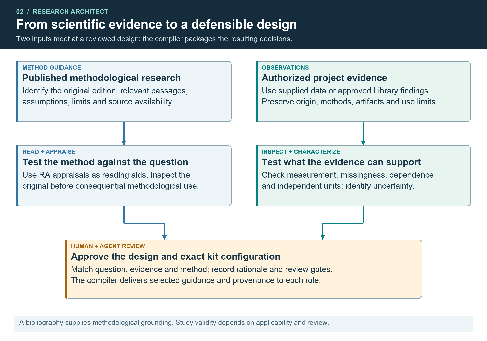
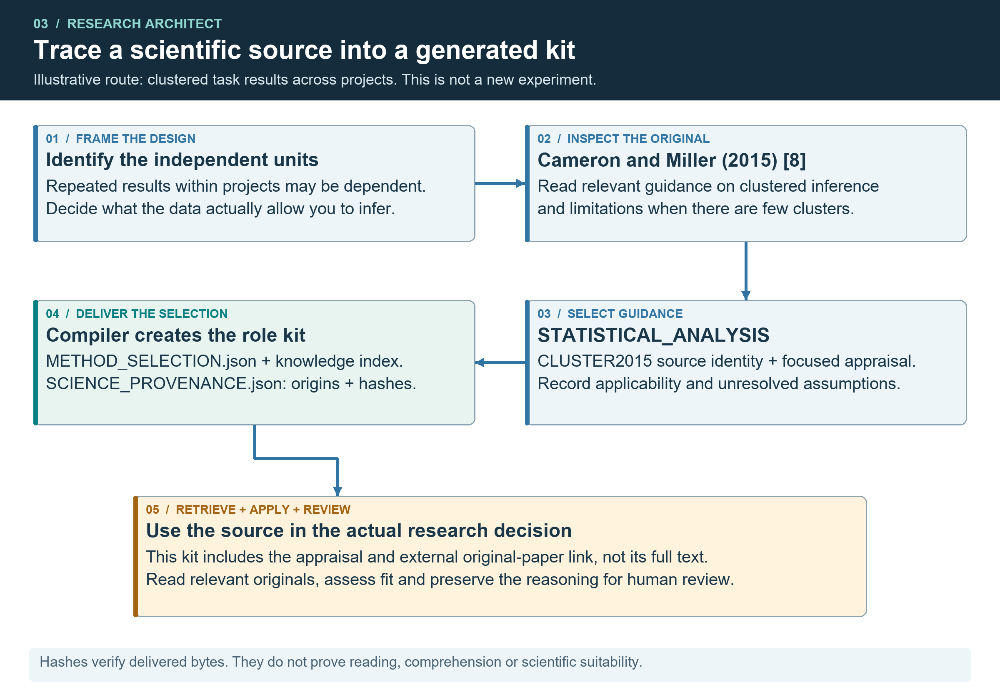
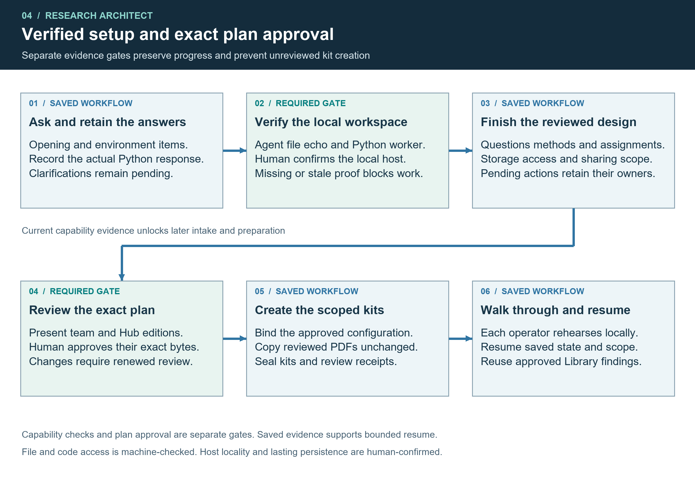

# Research Architect for Coordinated AI Research

Technical white paper with an operational case study from the NWSW project

Brandon Santor
Creator and Principal Designer of Research Architect
October 25 2026

## Executive summary

Research Architect provides an operating framework for human research teams working with AI. It converts a reviewed project design into individual role kits, preserves project state across sessions, records evidence and decisions, and supports versioned handoffs and recovery. The New World Screwworm (NWSW) deployment supplied an active setting in which these mechanisms were used and refined. A shared project Library retains approved research findings with methods, provenance, artifacts and review limits. The Hub has read/write access and alone publishes additions and corrections; Spokes and Ingestor have read-only access to approved evidence, returning new contributions through human review, Hub acceptance and Ingestor validation. [E5] [E6]

The documented results include creator-reported onboarding of eight people, verified remote exchanges, preservation of accumulated files during a live Hub upgrade and an isolated whole-project restore. The current RA 2.6.1 factory adds executable setup-environment verification, review of the exact written plan before kit creation, scoped delivery and retained approval evidence. Historical deployment results and current software tests retain their separate dates and work units. [E1] [E2] [E7]

Selected dated operational and release results [E1] [E2]

| Capability | Documented result and scope |
| --- | --- |
| Onboarding | Eight people reported onboarded by the creator on October 16; one framework configurator. |
| Exchange records | 262 unique transfer IDs in the October 16 inventory; individual receipts establish delivery. |
| Live upgrade continuity | 701 exchange files preserved and rehashed during the October 13 Hub upgrade. |
| Project recovery | 123,098 files verified in the original October 11 isolated restore exercise. |
| Release verification | 171 offline tests passed on Windows; no model calls or remote transfers in that run. |

This paper brings the engineering account to RA 2.6.1 while retaining the deployment case. Documented field operation includes Architect use in Codex and generated-kit operation across the reported Antigravity, Claude and Codex environments. RA requires a coding-capable agent workspace with persistent local files and code execution; any provider meeting those capabilities can qualify. The framework supplies usable software and coordination functions around existing models. Broader adoption and comparative research-quality effects remain questions for separate evaluation. [E7] [E8]

## 1 Introduction

AI-assisted research often spans several people, model sessions and collections of files. A useful answer becomes difficult to carry forward when the next session lacks its scope, supporting evidence, decisions or unresolved work. Teams also need to identify the current artifact, distinguish review from delivery and recover work after a session or machine changes.

Existing agent literature supplies useful design context. OpenAI describes models, tools and instructions as foundational components and discusses orchestration and guardrails. AutoGen demonstrates configurable conversations combining agents, tools and human input. Anthropic describes the coordination, evaluation and reliability work behind a deployed multi-agent research system. These sources inform the architectural context; their performance results are not evidence of RA performance. [1] [2] [3]

RA addresses the operating structure surrounding a research task. The Architect helps establish questions, assignments, methods, dependencies and review requirements. A compiler produces individual role kits and coordinated folders. Local helpers preserve state, inspect artifacts, prepare reviewed exchanges and support recovery. The selected coding-agent host supplies model inference and actual file/code access. These tools extend the workflow available to the agent without changing its model weights. Human operators retain responsibility for scientific judgments and consequential decisions. [E7]

## 2 System architecture

RA combines a reviewed project design, human-operated roles, persistent records and a shared project Library. Figure 1 separates Hub read/write access from Spoke and Ingestor read-only access. Only the Hub publishes additions and corrections. RA's scientific-methods collection supplies research guidance to the factory; the Library retains approved project findings for contextual reuse. Each host installation needs its own tested startup, storage and transfer configuration. [E3] [E4] [E5] [E6]

### Project design and role kits

The Hub issues bounded tasks, reviews contributions and validation results, obtains final human approval and uses its read/write Library authority to publish additions and corrections. Spokes conduct assigned work with their human operators, who accept and approve exact submissions. The Ingestor receives Hub-accepted work, validates it and reproduces results when needed, then returns its findings to the Hub. Generated kits carry these responsibilities, selected methods and continuity records. Generation does not grant remote access or establish scientific approval. [E6]

### Local agent workspace and verified setup

RA and its kits operate in an agent environment that can access persistent local project files and execute code on the machine. Codex, Antigravity and Claude Code are examples, rather than a provider whitelist. Uploading a ZIP to ordinary browser-only chat or running code in a temporary sandbox does not establish the required working environment. Manual file exchange and recovery remain useful between suitable local workspaces. [E7] [E8]

After the environment and Python responses, a bounded preflight requires an agent file challenge, saved readback and a result from an independent Python process. The environment respondent explicitly confirms the actual local agent workspace and persistent host. Missing, stale or withdrawn evidence blocks later intake and all supported kit-generation routes. File/code access is machine-checked; physical locality and long-term host durability are human-confirmed. The same saved evidence is rechecked on resume and before publication without repeatedly launching the worker. [E7]

### Written plan and scoped delivery

The finalized design produces a shared-team PDF and a Hub PDF. The shared edition contains the permitted team context and explicitly selected coordinator sections; the Hub edition also carries its approved coordinator records and setup responsibilities. Role-specific handoffs preserve the storage, transport, permissions, model plan, owners and pending actions relevant to each recipient. Generation does not configure cloud accounts or grant permissions. [E7]

Before kits can be created, the accountable human must approve the exact bytes of both plan editions, bound to the configuration and source snapshot. Compilation copies those reviewed PDFs unchanged and attaches separate review receipts. Changed configuration, intake or plan artifacts require renewed review; explicit refusal blocks creation. Existing approval events remain in history. The current build also requires the verified setup-environment receipt, so recorded prose alone cannot satisfy the local-capability requirement. [E7]

### Persistent context and source retrieval

Supported startup resolves the designated current checkpoint rather than choosing a directory by timestamp. A successor snapshot preserves its base and records changed state. A routed dictionary can direct a Hub to exact original evidence and prior decisions. The generic multipart reader preserves source text and hashes, repeats governing controls and exposes missing or altered parts. Its character limits are distinct from a model provider's token window; reading parts sequentially does not guarantee cumulative model retention.

Figure 1  Roles and Library authority. Teal arrows show Hub read/write access for additions and corrections. Dashed blue arrows show Spoke and Ingestor read-only access. Contributions return to the Hub; Figure 5 details review. [E3] [E4] [E5] [E6]

### Shared Library and cumulative project knowledge

The shared Library retains approved project evidence and outputs. Researchers and agents inspect prior findings, methods and artifacts for reuse within their recorded scope. The Hub reads the collection and is its sole writer of additions and corrections. Spokes and Ingestor have read-only access. This supplies the shared-learning mechanism: agents retrieve and interpret versioned project knowledge, carrying provenance into new work. [E5] [E6]

Discovery preserves canonical artifact and version identities, original locations, dependencies, review status and correction relationships. Membership references let one canonical item appear in several collections without duplicating the research output. Extracted packages retain their relative paths and parent bindings. A Hub-published correction can be exposed through both the canonical record and its discovery routes, helping agents recognize which version and limitations apply. [E5]

The outward availability labels are Available in Library and Request from Hub. Already-approved files and verified aliases remain usable within their original scope without repeating approval; safe metadata for held work directs a request to the Hub. Shared views use reviewed audience selections and omit restricted internal records. The Library is distinct from RA's bundled scientific-methods collection: the former retains a team's evolving evidence and outputs, while the latter supplies reusable research guidance for configuring kits. [E4] [E5]

### Evidence review and decision traceability

The Hub defines a bounded task with scope, inputs, methods, artifacts and acceptance criteria. The Spoke performs it, and its human approves the exact submission. The Hub reviews and accepts it for Ingestor validation and any needed reproduction. The Ingestor returns checks, discrepancies and limits. The Hub obtains final human approval, publishes the exact version with its use scope, and verifies publication. Failed checks return for correction and repeat affected reviews. Other roles propose Library corrections; only the Hub applies and publishes them, preserving prior versions and decisions. [E6]

Human-agent discussions can preserve the decisions, alternatives, objections and reasoning behind an output. The supported reviewer-bundle helper binds supplied conversation files and their declared session coverage to the research package for Hub review. All relevant supplied discussion remains available as evidence; summaries do not replace the transcripts. The helper does not automatically capture every host message, tool call or attachment, so missing coverage must be declared. Transcripts stay in restricted review storage; publishing a research finding does not automatically disclose its raw conversations. [E6]

### Versioned handoffs and recovery

Local helpers stage payloads, validate configured routes and retain receipts. Authorized host connectors perform remote transfer during active sessions. Preparation, delivery, reading, adoption, research acceptance and permitted downstream use remain distinct. Backup helpers verify selected project contents and captured external files, retain explicit recovery metadata and exercise restoration. Storage and transport configuration remain responsibilities of the deployment.

### Diagnostics and repair coordination

The Doctor diagnoses the explicitly selected kit and its configured components. It leaves the sealed kit unchanged while writing external reports and diagnostic-operation records. Its seven scopes cover identity, context, storage, messages, Library, backup and recovery. Compact findings retain complete evidence through bounded continuation. A clean result establishes the checked technical state, rather than scientific approval, and diagnosis does not itself authorize repair. [E7]

The Hub can coordinate a repair and relay the configured human authority's actual, bounded instruction to a Spoke. The Spoke's agent performs permitted work locally, subject to its operator/host controls and the recovery tool's checks. RA supplies no general Hub-issued repair capability or remote-control channel. For example, lock recovery requires the inspected lock hash, the same host and a proven dead owner process. Checkpoint recovery retains its clean-base, review and publication requirements. This preserves practical maintenance coordination without treating a Hub message as a tool grant. [E7]

## 3 NWSW deployment

The NWSW project provided an operational case for RA-generated kits and a coordinating Hub. The creator reported onboarding eight people by October 16, 2026, while remaining the only person who had run or configured the Architect itself. This is evidence of participant onboarding in a creator-supported deployment, rather than eight independent framework configurations. [E1]

The creator also reports running the Architect in Codex with Astra and 6.1 High, using those supplied model/setting labels, and running generated kits in Antigravity, Claude and Codex. Early browser-chat use caused operational problems that required teammate migrations to suitable local coding-agent workspaces. These are field-use reports, distinct from the smaller scripted early-intake trials. A missing platform name in an older test report does not establish that no kit ran on that platform. [E8]

The Hub maintained exchanges, source routes, instructions and checkpoints while the team continued assigned work. The original case examined selected operational records from October 8 through October 16. Later technical returns and Hub maintenance extend through October 23; current factory controls and runtime-use clarifications are included in this October 25 revision. Historical quantities below retain their observation dates; they are not estimates of the current complete project. [E1] [E7] [E8]

Generic RA, the deployed NWSW coordination system and the independent NWSW Spatial Evidence Workbench are separate systems. The Workbench's web interface, database, spatial features and application tests are not capabilities or validation results of the RA distribution. This paper reports coordination and software-engineering observations without publishing the project's research findings or contributor records.

## 4 Operational results

### File exchange and instruction continuity

The October 16 inventory recorded 98 incoming and 164 outgoing tickets with 262 unique transfer IDs. Tickets identify prepared exchanges; separate readback records support actual delivery. The October 8 repair distribution comprised 15 logical transfers and 30 remote objects. The October 13 distribution comprised 10 transfers and 20 remote files. The retained checks bound delivered objects to their intended destinations and bytes. [E1]

A complete versioned instruction was delivered through seven participant routes in October. Its register retained identity, version, supersession and observed delivery, with a subsequent report of retention and application. That report does not establish seven persistent installations. Later diagnostic returns and exported execution records strengthened evidence for participant-side setup and multipart restoration, while remaining distinct from independent observation of every device. [E1]

### Continuity during engineering changes

The authorized October 13 Hub upgrade preserved and rehashed 701 exchange files, totaling approximately 1.66 GB. Its preceding exchange store and pointer remained unchanged. The post-activation exercise combined file-hash comparison with inventory checks and verified restoration records. This is a demonstrated preservation result for that upgrade, rather than a guarantee that arbitrary concurrent writers can be merged safely. [E1]

An October 15 native Windows context-repair fixture reconstructed a 466,824-character startup section through five resume parts and eight full-context parts. The largest part contained 189,188 characters under the unchanged 200,000-character ceiling. Checks included Unicode and CRLF reconstruction, repeated controls, missing or altered parts and later checkpoint restoration. These are synthetic engineering checks, separate from participant adoption. [E1]

### Whole project backup and restoration

The October 11 capture covered 48 included Drive folders, 744 source files and 748 downloaded or exported artifacts, together with local project contents and dependencies. The original isolated restore verified 123,098 files totaling approximately 20.88 GB without using live sources. It materialized recorded dependencies and completed restored integrity and context checks. [E1]

A later authorized content amendment produced a separately documented backup inventory. It does not replace the historical restore result or authorize resurrection of excluded bytes. The deployment's two-copy rolling policy is project-specific; the reusable tools accept explicit retention configuration. Local backup and restore were evidenced, while actual offsite delivery was not established by the inspected capture records. [E1]

### Shared Library implementation and publication recovery

The NWSW implementation established preserved holdings, a private census and evidence registers, immutable shared catalog generations, approved stored files and a pinned deployment graph. Readers follow the current designation through the deployment and relevant collection pages. This supports targeted discovery without scanning all research payloads or loading the full collection into model context. The implementation preserves prior versions and exact review bindings when registering reviewed additions and corrections. [E5]

The retained recovery completion records successful verification of the selected catalog, 58 convenience aliases and the status record, followed by guard release. Its final current-pointer observation was October 22, 2026 at 11:51 p.m. Central Daylight Time (October 23 at 04:51 UTC). Separate Hub activation completed at 12:30 a.m. CDT on October 23. These are completed, dated operational results. They establish the recorded publication and recovery outcome; contributor rollout and recipient reading remain separately tracked. [E5]

## 5 Engineering improvements and release verification

Field operation exposed requirements for stable state selection, reliable Windows publication, growing context and recoverable exchanges. RA 2.1.0 distribution revision 2 ports reusable mechanisms into a separate package while preserving earlier source and deployed project history.

Capabilities in the inspected RA 2.1 distribution

| Capability | Implemented mechanism |
| --- | --- |
| Current state selection | Verified designation, identity and manifest checks; invalid selectors stop affected work. |
| State publication | Separate successor snapshots, destination-local staging and expected-base checks. |
| Context continuity | Bounded retrieval and exact multipart restoration with repeated controls. |
| Exchange records | Configured local staging, version-bound receipts, idempotent repeats and guarded lock recovery. |
| Project recovery | Resumable capture, explicit retention, dependency materialization and standalone restore tools. |

The October 16 release receipt records 171 passing offline regression tests in eleven groups on Windows and Python 3.12.10, with zero failures, errors or skips. Coverage included kit generation, checkpoints, context reconstruction, local exchange, affected evidence services, extracted-package generation and rebuilding, and backup recovery. The run made no model calls or remote transfers. The earlier edition's read-only comparison found all 278 recorded source hashes unchanged. That integrity comparison is not a new regression run. [E2]

Instruction maintenance has a separate boundary. RA records stable IDs, complete versioned text, authority, applicability and explicit supersession. Routine Hub saves may append evidenced observations about an existing instruction, but cannot define or rewrite a rule. A new startup instruction requires reviewed reconfiguration and verification that the selected installation actually loads it. Delivered packages and acknowledgments alone do not establish fresh-session behavior.

The deployed Hub continued to evolve after the historical RA 2.1 package freeze. Later context and message improvements informed the reusable RA 2.3 implementation and remain in the current factory. In a retained repeated-context fixture, emitted prompt length fell from 773,391 to 119,362 characters, an 84.5664% reduction, with matching source hashes and complete reconstruction; confirmed same-conversation reuse emitted 277 characters. These are scenario-specific output measurements. Provider-token counts, billing and whole-task productivity are separate measures. [E1] [E7]

### Current factory configuration and verification

The current factory is RA 2.6.1, with operational runtime 2.4.0 and scientific library 1.9. These identifiers distinguish kit preparation, operational helpers and methodological content. Manifests and startup text identify the delivered components. Factory updates carry forward the existing Library, context, backup and exchange mechanisms while adding configuration and delivery controls. Existing deployments and dated measurements retain their original identities. [E3] [E6] [E7]

New sessions use a persistent setup ledger with 43 baseline questions and additional required followups. Compact status identifies the pending item on each turn and after resume. Environment/Python answers require the separate verified preflight before later intake. Ordinary compilation then requires completed responses, explicit human preparation approval, the exact configuration binding and current review of both plan PDFs. Deferrals remain pending; changed decisions preserve history and reopen affected work. Build verification and each operator's walkthrough remain separate completion stages. Existing protocol-1 ledgers retain their 42-item catalog and historical approvals. [E3] [E6] [E7]

The RA 2.5 revision 1 verification exercised the changed question workflow, interrupted and stale-state paths, configuration binding and the extracted package. A synthetic four-role project compiled, each generated kit passed its consistency check and actual operator walkthroughs remained pending. Three teaching-runner defects were repaired: all-failed-project handling, infeasible sensitivity shifts and bounded duplicate-safe JSON input. Earlier operational experiments were retained rather than rerun. Revision 2 changes release identification and documentation; its adjacent integrity receipt records only those changed-path checks. [E3]

The scientific collection contains 134 reference records and 38 local reference texts. Six targeted critical appraisals cover methodology, agent evaluation, failure analysis and computational reproducibility, with dependencies across 19 method routes. Complete runnable teaching cases address clustered workflow evaluation, nested model selection and target-population generalization. They pair declared plans, fixed data, analysis, diagnostics and bounded conclusions with applicability safeguards. Large source bodies remain retrievable on demand. These counts describe coverage and availability, rather than 134 completed full-paper reviews. [E3] [E4]

The reusable Library integration introduced in RA 2.3 remains in RA 2.6.1. Every generated role receives a configurable discovery client that verifies catalog revision, hashes, byte counts and audience, preserves complete matching metadata through continuation and prepares submission records for Hub review. The discovery client grants no write authority. Spokes and Ingestor have read-only Library access; the Hub has read/write authority and uses authorized tooling to publish additions and corrections. Earlier registration/discovery evidence is retained. Generating a kit does not install the NWSW backend or grant access to its holdings. [E3] [E5] [E6] [E7]

The opening invitation is the first required item in new protocol-2 sessions. Questions about setup remain pending until the human chooses to begin intake. Targeted compiler checks rejected 14 representative required-item omissions and preserved legacy ledgers and approvals. In a two-turn fresh-chat test using gpt-5.6-sol at low reasoning, the agent asked the invitation, explained approval and recorded a request for explanation as a deferral with zero answers. These results document early-intake behavior and structural gate enforcement; the full interview was not rerun. [E6]

The written-plan implementation was checked through eight focused test groups. The exact-PDF review gate was then exercised through eleven review-to-build groups and five refusal/renewal checks. Successful compilation copied the reviewed bytes while rendering was disabled; changed plan evidence blocked publication. Separate role-delivery checks verified local-runtime instructions in fresh Hub, Ingestor and Spoke kits and their resume context. These records establish the particular software paths exercised, rather than a new complete interview or independent team trial. [E7]

The current environment gate passed eight focused groups and six additional negative entry-point checks. Unsupported answers could not complete step 1, and missing evidence blocked readiness, approval, workflow-backed export and normal/draft/direct generation. Changed evidence, host/workspace drift, code failure or timeout and withdrawn confirmation remained blocked. One successful four-role build preserved the earlier configuration and PDF approval bytes; an interrupted-publication case stopped after capability evidence changed. These are synthetic engineering scenarios using real file/code execution. They are distinct from the field deployment and retain the underlying test receipts. [E7]

## 6 Research basis and methodological applicability

Multi-agent design requires explicit coordination and verification. Cemri and colleagues distinguish system-design, inter-agent alignment and task-verification failures. RA uses this taxonomy to examine pending questions, task drift and incomplete completion checks. Applying the taxonomy is an engineering interpretation, not evidence that RA shares the study's failure rates or has eliminated those failure modes. [4]

AI Agents That Matter argues for cost-aware evaluation, credible simpler baselines and holdouts matched to the intended generalization. RA adopts these considerations when planning comparisons: report the full retry policy and task denominator, and distinguish emitted characters from measured tokens and billed cost. The appraisal uses the explicitly identified 2024 author edition; it does not treat later publication as evidence of a new RA experiment. [5]

CORE-Bench evaluates computational reproduction using supplied code and data. Its inspected author version and separate journal publication identity are distinguished in the references. Reproducing an expected output is a useful verification target, but it does not independently establish the truth of a study's measurements or causal interpretation. RA therefore records file integrity, execution, operator rehearsal and scientific review separately. [6]

Preregistration guidance distinguishes prospective plans from choices made after seeing outcomes. RA's preparation approval concerns kit creation, not preregistration of a study. Applicable research plans should record timing, prior outcome exposure and deviations while preserving exploratory work under an accurate label. [7]

Clustered-inference guidance explains why observations within the same project or task group cannot automatically be counted as independent evidence. RA's workflow-evaluation case distinguishes all-attempt outcomes from completed-pair diagnostics; statistical inference must respect the design's independent units and few-cluster limits. The teaching case is an application of methodological principles, not a new empirical validation of them. [8]

Leakage analysis requires separation through preprocessing and evaluation, legitimate predictors and a test distribution that matches the scientific claim. RA's analysis-selection guidance carries these checks into model comparison. Nested selection or a held-out split does not repair inappropriate measurements or an unsupported target-population claim. [9]

FAIR principles emphasize identifiable, described and reusable research objects; practical scientific-computing guidance supports preserving raw inputs, processing records and change history. These sources inform RA's provenance and handoff design. RA's actual preservation and restore results are supported by its retained deployment receipts, not inferred from citing those principles. [10] [11] [E1]

## 7 Discussion and next phase

RA has supported continuing work across people, sessions and files. Role kits supplied assignments and governing context, checkpoints retained decisions and unresolved work, and verified exchanges made distribution traceable. The isolated restore established a recovery path. Operational defects supplied reproducible cases for the reusable package.

### Scope and assurance

The evidence combines creator-reported deployment experience, retained execution receipts, recipient returns, synthetic software checks and observed model conversations. Reports of Architect and kit use across named hosts are part of that evidence. The smaller GPT-5.6-sol early-intake trials describe their own scripted scenarios; they are not an exhaustive history of live use. Each execution report supports the operation and measures it records. Further independent-lead or comparative evaluation adds evidence without negating those observed results. [E1] [E6] [E7] [E8]

File consistency does not authenticate authors or certify scientific validity. Human decisions remain distinct from technical checks, and local accounts and host configuration remain trust boundaries. Folder visibility alone does not establish research-use permission. Locks and selection checks do not form one transaction across uploads, designation and unrelated writers; cutover needs an idle window and reconciliation.

### Late-stage onboarding of participants and agents

Late-stage onboarding places separate demands on a new participant and their newly generated agent. The person must learn the project, while the agent must reconstruct the relevant decisions, terminology, evidence, dependencies and unresolved work. An experienced participant introducing a fresh agent still faces the agent's context gap. A role kit can contain supplied project context, but generating it does not automatically transfer the established team's accumulated working understanding.

This is a limitation of context transfer and assimilation in the AI technology on which RA depends. Shared Library access makes retained information available; it does not by itself establish that a new agent has selected, read, reconciled and understood the material needed for its assignment. While onboarding proceeds, the project continues producing and revising context. If relevant changes accumulate faster than the person and agent can assimilate them, a persistent catch-up backlog can develop. Loading more records is not equivalent to establishing current, usable understanding.

The lead and existing team must then supply explanations, identify authoritative records, resolve misunderstandings and verify the new pair's work. Existing agents may also spend context and inference resources assisting the newcomer. This diverts attention from established workstreams, can slow the team and can make late expansion impractical within the available time and cost budget. Adding a kit should therefore not be assumed to increase useful capacity. The severity depends on the role, project pace and completeness of retained reasoning; this is a technology and workflow limitation, not a measured claim that every late entrant can never become ready. Checkpoint restoration of an established workstream remains distinct from onboarding a new participant and agent.

### Context and performance evaluation

Bounded retrieval and durable checkpoints provide practical control over working context. The documented fixture reductions establish lower emitted prompt volume in their tested scenarios. End-to-end evaluation should additionally count initialization, tool results, saving, restoration, retries and failures, with actual provider usage and billing where available. The paper does not convert character reductions into an unsupported token-cost or research-quality percentage. Comparable tasks, credible simpler baselines and claim-matched holdouts remain necessary for broader efficiency estimates. [5] [9] [E7]

### Broader adoption

A useful next milestone is another project lead configuring a new team with documented support requirements. The reported cross-host operations provide field experience; systematic comparisons should identify the loaded startup guidance, selected checkpoint, complete restoration and behavior in fresh and resumed sessions. Existing-project adoption requires preserved state, compatibility checks, reviewed updates and deliberate cutover. Automatic migration across unrelated projects is a separate capability from the existing reviewed maintenance tools. [E7] [E8]

The historical RA 2.1 case and current RA 2.6.1 factory remain development previews. Additional-lead adoption and systematic platform comparisons are distinct from the implemented setup gates, Library client, source retrieval and reported multi-host kit operation. Claims remain tied to their actual records and observation dates. [E1] [E7] [E8]

## 8 Conclusion

Research Architect has supported a creator-configured team with verified exchanges, preserved history and whole-project recovery. Field experience informed reusable context, Library and maintenance improvements. The current factory adds explicit capability evidence, a human-reviewed written plan and verified delivery while preserving prior decisions. These results support a reusable, human-supervised operating structure with traceable engineering evidence. Continued evaluation can test its setup burden, comparative costs and research-quality effects across additional leads and projects. [E1] [E7] [E8]

## Visual guide from evidence to research design

RA draws on two complementary inputs. Published methodology explains how a design can support a claim; project evidence supplies the observations to which that design will apply. The Architect must assess their fit before selecting guidance for a kit. The compiler packages the resulting selection. It does not independently choose a scientifically valid study. [E3] [E4]

Figure 2  Published research and project evidence inform a reviewed design. Arrows show the intended reasoning and configuration flow, including scientific judgments that require agent and human review.

The scientific registry records source identities and availability. Local text is supplied where the retained collection permits it; other records point to an external original. Project data must be supplied or obtained through authorized project workflows. RA does not turn a bibliography into a dataset or treat technical integrity checks as scientific approval. The design should identify the question, independent units, measurement limits and relevant assumptions before a method is accepted. [8] [9] [10]

## Visual guide tracing a cited method into a kit

Consider an illustrative evaluation with repeated task results within projects. The statistical guidance directs attention to dependence and independent units. Cameron and Miller provides relevant methodological grounding; the retained CLUSTER2015 appraisal identifies the original sections inspected and the limits of applying their guidance. This example explains a source route, not a newly conducted experiment. [8] [E4]

Figure 3  The STATISTICAL_ANALYSIS route includes the CLUSTER2015 source record and focused appraisal. The compiler carries selected guidance, a filtered index and provenance into generated kits. [E3] [E4]

For this source, the kit carries bibliographic metadata, an original-paper link and an RA-authored appraisal; it does not contain the full original paper. Other selected sources may have local full text. The knowledge reader supports targeted retrieval of local material, while consequential use requires inspection of the relevant original passages. Hashes establish which bytes were delivered. They do not establish that a model read the material or that clustered inference is suitable for the particular study. [8] [E4]

## Visual guide questions and continuity

RA stores setup progress in a persistent ledger. Compact status identifies the pending question on each setup turn and after resume; clarification is not completion. After the environment/Python responses, actual capability evidence and local-host confirmation unlock later intake. The finalized design then produces the exact PDFs for human review. Only current environment evidence, completed requirements and the bound plan approval permit kit creation. Figure 4 shows these distinct gates and the subsequent walkthrough/resume stages. [E7]

Figure 4  Verified setup, exact plan review and continuity. File/code evidence and explicit local-host confirmation precede later intake. The human reviews both plan editions before kits are created from those unchanged bytes. Operator walkthroughs and saved-state restoration remain separate. Legacy approval history is preserved. [E7]

Preparation approval is bound to the exact configuration inputs and reviewed PDF identities. A separate environment receipt binds the setup workspace, current prerequisite answers, interpreter, machine and verification tools. Changes invalidate the affected evidence; attaching a capability receipt to unchanged approved records does not rewrite them. These controls enforce the supported preparation paths. They do not prove human comprehension, permanent host persistence or perfect instruction following by every model. The retained conversation trials and software checks remain separately scoped. [E6] [E7]

## Visual guide sharing and reusing Library evidence

The Hub issues a bounded task; a Spoke performs it and obtains its human's approval. The Hub reviews and accepts the contribution for Ingestor validation and any needed reproduction. The Ingestor reports back, the Hub obtains final approval, and only the Hub publishes the approved finding. The Hub retains read/write access and alone publishes later corrections after the required reviews. Spokes and Ingestor discover and read approved evidence through read-only access. Figure 5 shows the required sequence. [E6]

Figure 5  Task, review, validation and Hub-only publication. The Hub has read/write authority and alone publishes additions and corrections; Spokes and Ingestor have read-only access. Human submission approval and final approval are separate decisions. Methods, artifacts, provenance and limits accompany the published finding. Conversation evidence supports restricted Hub review. [E6]

The Hub's authorized publication tooling verifies immutable catalog files and deployment bindings before selecting CURRENT and reconciling convenience aliases. Writer guards, expected prior state and retained receipts support interrupted-operation recovery. Only the Hub applies Library changes through this tooling; other roles submit proposed corrections to the Hub. The review sequence governs kit instructions; existing tools enforce their own checks rather than one automatic end-to-end approval engine. A flowchart does not change storage permissions or authenticate human decisions. [E5] [E6]

## References

[1] OpenAI. (n.d.). [A practical guide to building agents](https://cdn.openai.com/business-guides-and-resources/a-practical-guide-to-building-agents.pdf). OpenAI. Technical guide. Accessed October 23 2026.

[2] Wu Q, et al. (2024). [AutoGen: Enabling Next-Gen LLM Applications via Multi-Agent Conversations](https://www.microsoft.com/en-us/research/wp-content/uploads/2023/08/LLM_agent.pdf). COLM 2024. Peer-reviewed conference paper. Accessed October 23 2026.

[3] Anthropic. (2025). [How we built our multi-agent research system](https://www.anthropic.com/research/multi-agent-research-system). Anthropic Engineering, June 13. Engineering report. Accessed October 23 2026.

[4] Cemri M, et al. (2025). [Why Do Multi-Agent LLM Systems Fail?](https://papers.nips.cc/paper_files/paper/2025/hash/b1041e52d3be19f0a9bc491657488e4a-Abstract-Datasets_and_Benchmarks_Track.html). NeurIPS 2025 Datasets and Benchmarks. peer-reviewed conference paper. DOI: 10.52202/085713-4082. Accessed October 23 2026.

[5] Kapoor S, Stroebl B, Siegel ZS, Nadgir N, Narayanan A. (2024). [AI Agents That Matter](https://arxiv.org/abs/2407.01502v1). arXiv:2407.01502v1. Inspected author preprint; later journal publication in TMLR 2025. Published record: [https://openreview.net/pdf?id=Zy4uFzMviZ](https://openreview.net/pdf?id=Zy4uFzMviZ). Accessed October 23 2026.

[6] Siegel ZS, Kapoor S, Nadgir N, Stroebl B, Narayanan A. (2026). [CORE-Bench: Fostering the Credibility of Published Research Through a Computational Reproducibility Agent Benchmark](https://arxiv.org/abs/2409.11363v2). arXiv:2409.11363v2, revised June 22 2026. Inspected author version; published journal record in TMLR 2025. Published record: [https://openreview.net/pdf?id=BsMMc4MEGS](https://openreview.net/pdf?id=BsMMc4MEGS). Accessed October 23 2026.

[7] Nosek BA, Ebersole CR, DeHaven AC, Mellor DT. (2018). [The preregistration revolution](https://doi.org/10.1073/pnas.1708274114). Proceedings of the National Academy of Sciences of the United States of America. published journal article. DOI: 10.1073/pnas.1708274114. Accessed October 23 2026.

[8] Cameron AC, Miller DL. (2015). [A Practitioner’s Guide to Cluster-Robust Inference](https://doi.org/10.3368/jhr.50.2.317). Journal of Human Resources. published journal methodological article. DOI: 10.3368/jhr.50.2.317. Accessed October 23 2026.

[9] Kapoor S, Narayanan A. (2023). [Leakage and the reproducibility crisis in machine-learning-based science](https://doi.org/10.1016/j.patter.2023.100804). Patterns (New York, N.Y.). published journal article. DOI: 10.1016/j.patter.2023.100804. Accessed October 23 2026.

[10] Wilkinson MD, et al. (2016). [The FAIR Guiding Principles for scientific data management and stewardship](https://doi.org/10.1038/sdata.2016.18). Scientific data. published journal article. DOI: 10.1038/sdata.2016.18. Accessed October 23 2026.

[11] Wilson G, Bryan J, Cranston K, Kitzes J, Nederbragt L, Teal TK. (2017). [Good enough practices in scientific computing](https://doi.org/10.1371/journal.pcbi.1005510). PLoS computational biology. published journal article. DOI: 10.1371/journal.pcbi.1005510. Accessed October 23 2026.

### Primary RA evidence records

[E1] Santor B. NWSW operational case evidence register, October 8-22 2026. Retained private creator report, transfer inventories and readbacks, upgrade-preservation records, context fixtures and isolated-restore receipts. Reviewed locators and hashes are held in the editorial evidence manifest. These are primary project records, not independent peer-reviewed findings.

[E2] Santor B. Research Architect 2.1.0 distribution revision 2 release verification, October 16 2026. Retained offline regression and package-verification receipts: 171 tests; no model calls or remote transfers. The earlier editorial integrity comparison is retained without a new regression run.

[E3] Santor B. Research Architect 2.5.0 release notes and changed-path verification, October 23 2026. Distribution revision 1 records the new setup gate, runner repairs and extracted four-role project checks. Distribution revision 2 records release-label and citation changes. Exact archive identities and verification scopes accompany each release in its integrity receipt.

[E4] Santor B. Research Architect scientific library 1.9 source registry and six critical applicability appraisals, October 23 2026. Records source identity, actual inspected edition/sections and application limits. RA-authored synthesis is separate from the original publications.

[E5] Santor B. NWSW shared Library implementation, verified publication recovery and RA client integration records, October 22-23 2026. Maintained implementation manifest R2; recovered Library completion protocol 3; separate Hub activation receipt; and retained RA client registration/discovery test. The Library completion binds CURRENT, 58 aliases and the status record. These are primary engineering and operational records; local integration tests and deployed recovery are distinguished. Exact source hashes and private locators are retained in the editorial evidence manifest.

[E6] Santor B. Research Architect 2.5.1 implementation and verification records, October 23 2026. Versioned setup-workflow source and generated Hub, Spoke and Ingestor instructions; evidence-review and Library-client documentation; transcript-export implementation; retained compiler-omission, legacy-preservation and three-role delivery checks; and a recorded two-turn gpt-5.6-sol low-reasoning intake test. Source inspection establishes implemented controls and supplied instructions; test receipts establish the specific behaviors exercised. These records are distinct from the dated NWSW deployment evidence. File identities and verification scopes are retained with the release.

[E7] Santor B. Research Architect 2.3 through 2.6.1 implementation and scoped verification records, compiled October 25 2026. Retained context measurements, setup handoff and plan delivery checks, exact-PDF review and refusal tests, three-role instruction delivery, and the environment gate's eight focused groups and six negative entry-point checks. Release reports and hash-pinned receipts record each scope. This paper revision reran no operational or scientific suites.

[E8] Santor B. Creator account of runtime use and browser-host migrations, retained with RA 2.6.1 field-use documentation. Reports Architect use in Codex with Astra and 6.1 High, kit operation in Antigravity, Claude and Codex, and browser-chat problems requiring teammate migrations. Labels and outcomes are creator-reported field evidence; no controlled platform benchmark or new adoption rate is inferred.

### Evidence availability

The public paper reports aggregate engineering observations from retained deployment records, dated software receipts and creator accounts. Participant records and research payloads remain private. Exact locators, hashes and evidence classifications are retained for editorial review. The cited research supplies methodological context; RA's engineering results are supported by its own records.

### Reading the engineering evidence

Results retain their dates and units. Transfer IDs count recorded exchanges; the isolated restore and context fixture establish their specific recovery and output results. Regression reports cover their named software paths. These observations support the operating mechanisms described here without forming an independent adoption rate or research-quality effect.

Future comparisons should freeze tasks, authorized evidence, runtime settings, stopping rules and grading criteria. Compare context strategies on the same tasks and include retries, failures and restoration work. Record actual usage when available and retain unavailable counters as unknown. Assess citations, uncertainty and unauthorized actions alongside completion. This is an evaluation plan. [5] [8] [9]

Prepared with AI-assisted source review and drafting. Brandon Santor configured the deployment and supplied the creator accounts. Execution records, recipient reports and independent evaluation retain their respective scopes.
